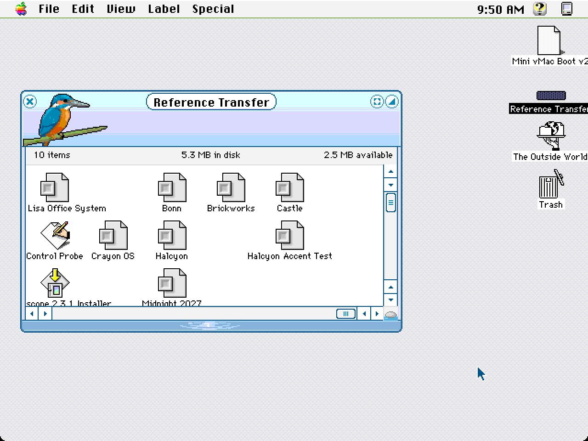

# Authoring a Kaleidoscope scheme in code

*Audience: an engineer new to this repo who wants to make a new theme. No
classic Mac experience needed.*

Most of this repo reads and renders schemes that people made in the 1990s.
This guide covers the opposite direction: writing a new scheme from scratch
with code. The worked example is **Halcyon** (`authoring/schemes/halcyon/`),
a light, frosted, modern-looking scheme made entirely with the tools
described here.


## 1. What you are making

A Kaleidoscope scheme is a single binary file called a **resource fork**. Think
of it as a typed key–value store: every entry has a 4-letter **type**, a
numeric **id**, an optional name, and some bytes.

| Type | What it is | Used for |
|---|---|---|
| `cicn` | a small colour image with a 1-bit transparency mask | window frames, button faces, checkboxes |
| `wnd#` | a window layout recipe | how a frame image stretches to any window size |
| `cinf` | 18 bytes of metadata for one image | button corner sizes, and which pixel holds the text colour |
| `Colr` | scheme-wide flags | not used for rendering today; ship it for completeness |
| `vers` | a version record | shown in the Finder; optional |

The **id** says what an entry is for. For example, `wnd# -14336` is the
document window recipe, and `cicn -10239` is the normal push button face.
Section 6 lists the ids Halcyon uses.

Scriptoscope's runtime loads the file, decodes each entry, and draws windows
and controls from them. Anything the scheme leaves out falls back to a
built-in gray Platinum look.

## 2. Quick start

```sh
npm install
npm run author -- authoring/schemes/halcyon   # writes authoring/schemes/halcyon/scheme.rsrc
npm run dev
# open http://localhost:5173/authoring-preview.html
```

`npm run author` does four things:

1. runs `buildScheme()` from the scheme's `scheme.mjs`, which returns a list of resources;
2. packs them into resource-fork bytes and loads those bytes back through
   **the same converter the browser uses**;
3. runs the authoring checks (section 7) and prints what it found;
4. writes two files, only if there were no errors:
   - `scheme.rsrc`: the raw resource fork, which Scriptoscope loads;
   - `scheme.bin`: the same fork as a **MacBinary** file, for a classic Mac (below).

   On an error the old files are left as they were and the command exits with
   status 1, so a problem shows up here, not later in the browser. Warnings are
   printed but don't stop the build.

If you edit a first-party scheme (Halcyon, Castle, Brickworks or Bonn), rebuild
it before running `npm test`: tests check that the committed `scheme.rsrc` and
`scheme.bin` match a fresh build. Experiments under `authoring/experiments/`
don't commit their builds; run `npm run author` on them before previewing.

**Why two files?** On a classic Mac a file has two parts (a data fork and a
resource fork) plus Finder info: a 4-letter file *type* and *creator*. Every
Kaleidoscope scheme has type `Colr` and creator `Acid`, and the resources live
in the resource fork. Modern file systems and git keep only one stream per
file, so `scheme.rsrc` holds just the resource bytes, with no type or creator.
MacBinary packs both forks and the Finder info into one ordinary file.
StuffIt Expander, MacBinary utilities and hfsutils (`hcopy -m`) turn it back
into a real scheme file on a classic Mac or an emulator disk.

Two flags add review aids, written even when the checks fail:

- `--sheet` writes `<dir>/sheet.png`: every `cicn` (and every `ppat`, tiled
  2×2) at 4× on a checkerboard, grouped by family and labelled with id and
  size, with the same images through the 8-bit simulation beside them. Don't
  commit it.
- `--palette` prints the palette report for `<dir>/palette.mjs`: where each
  colour lands on the 8-bit system palette, which colours collapse onto one
  entry, and the contrast of the title and button colours the engine samples
  (plus any pairs the palette exports as `CONTRAST = [[fg, bg, label], …]`).

To see a whole preview the way an 8-bit classic screen would, run
`npm run sim8 -- authoring/schemes/halcyon/preview.png /tmp/sim8.png --dpr 2`
([`authoring-visual-design.md`](./authoring-visual-design.md) §3.4).

Try it: change `accent` in the palette at the top of
`authoring/schemes/halcyon/scheme.mjs`, rebuild, and reload the preview.

To view any other scheme file, use
`authoring-preview.html?scheme=/authoring/schemes/<name>/scheme.rsrc`, or drop
the `.rsrc` file on the "Load your own" tile of the showcase page.

## 3. The toolkit (`tools/theme-author/`)

The authoring toolkit is the write-side twin of `tools/theme-loader/`. Every
encoder is the inverse of a decoder there, and the tests prove the round trip.

| File | What it does |
|---|---|
| `raster.js` | `Raster`: an RGBA drawing surface with `fillRect`, `fillRoundRect`, `clipRounded`, `sprite` (ASCII art), `blit`, `swatch`, the smooth shapes (§4.5) and `Raster.fromRgba` for imported art; plus `verticalGradient`, `ditheredGradient` and `bayer`. **`outlineEdges(0, 0, w, h, colour)` outlines a whole silhouette**; two builders wrote their own before finding it |
| `fit-palette.js` | `fitPalette(raster)`: merges the rarest colours until an image fits the 256-colour limit, keeping hidden swatches exact; `colorCount(raster)` |
| `encode-cicn.js` | `encodeCicn(raster)`: builds the palette, picks the bit depth, writes mask, B/W fallback and pixels |
| `encode-ppat.js` | `encodePpat(raster)`: tiling patterns (desktop, window backgrounds, progress stripes) |
| `encode-icons.js` | `encodeIconFamily`, `encodeIconPlane`, `encodeIconList`: Finder-style icons (`ICN#`, `icl8`, `icl4`, `ics#`, `ics8`, `ics4`) in the system palettes |
| `encode-clut.js` | `encodeClut`, `encodeHeaderClut`: colour tables, e.g. the window header colours |
| `encode-strings.js` | `encodeStrList` (`STR#`), `toMacRoman`, `pascalString` |
| `encode-dialog.js` | `encodeDlog`, `encodeDitl`: dialog templates (the about box) |
| `encode-crsr.js` | `encodeCrsr`: a 16×16 colour cursor from a raster |
| `encode-snd.js` | `encodeSnd`: an 8-bit sampled `snd `; `synthesize`: a small deterministic synthesizer for original sounds |
| `classic-extras.js` | `aboutBox`, `arrowCursors`, `shadeSounds`: the control-panel extras in one call each (§6) |
| `macbinary.js` | `writeMacBinary`: packs the fork with type `Colr` / creator `Acid` for a classic Mac (§2) |
| `encode-records.js` | `encodeWnd`, `encodeCinf`, `encodeColr`, `encodeVers` |
| `window-layout.js` | `windowLayout(spec)`: one description gives both the frame geometry and a matching `wnd#` recipe, for simple rounded frames |
| `frame-layout.js` | `frameLayout(spec)`: explicit cell lists per edge, for frames that aren't rectangles (tiles, towers above the bar, end caps, per-edge art), with named cells to paint by; `stripLayout` and `pressedStripFrom` for the pressed-widget strip |
| `resource-fork-writer.js` | `writeResourceFork(resources)`: builds the binary file |
| `check-scheme.js` | `checkScheme(resources)`: authoring checks (section 7) |
| `color.js` | colour parsing and the gamma pre-compensation (section 4.4) |
| `sim8.js` | `simulate8bit(image)`: quantises an image the way an 8 bpp classic screen would; `systemEntryFor(colour)` for one colour |
| `palette-report.js` | `paletteReport(palette, { pairs })`: 8-bit entry and distance per colour, collapses, WCAG contrast; `contrastRatio` |
| `contact-sheet.js` | `contactSheet(resources, { sim8 })`: the image behind `--sheet` |

The writers are checked against the real corpus. Re-writing all 18 bundled
schemes with `writeResourceFork` returns every resource byte for byte, and
re-encoding all 3,325 corpus `cicn`s with `encodeCicn` gives identical pixels.
The same holds for all 217 indexed corpus `ppat`s, 4,937 colour icon planes,
2,803 black-and-white icon planes and 60 `clut`s, and for every corpus
`STR#`, about-box `DLOG`/`DITL`, `crsr` and standard-header format-1 `snd `
(`encode-classic.test.mjs`; the loader has no decoder for these, so the test
reads them itself).

## 4. Five ideas you need

### 4.1 A window is one small image plus a stretching recipe

You never draw a window at its final size. You draw a **template**: the
smallest version of the window, perhaps 80×30 px. The `wnd#` recipe says
which columns and rows may repeat when the window grows.

Each edge (top, bottom, left, right) has a list of **borders**: positions in
the template. Consecutive borders form **cells**, and each cell has a **part
code** that says how it behaves:

```
template top edge:   0        30 31 32 33          81
                     │ fixed  │g │P │g │   fixed    │
part code:              1      11  5  8      1
```

| Part code | Behaviour | Use it for |
|---|---|---|
| 1 | fixed: drawn once, 1:1 | corners and anything containing a widget |
| 8, 11 | grow: the source column repeats (tiles) to fill extra space; 11 tiles from the far end | plain stretches of border or title bar |
| 5 | title plate: widened to the title's width and centred | the strip behind the title text |
| 6 | title bezel: fixed, hidden when the title doesn't fit | end caps around the plate |
| 0 | collapse: zero width | skipping template columns on one edge, e.g. a bottom with less art than the top |
| 2, 3, 4 | fixed while the window has a close / zoom / collapse box; zero width when it doesn't | space that belongs to that widget |
| 10 | fixed, but dropped (with the title) when the window is narrower than the edge's fixed cells | optional decoration |
| 12 | tile in whole copies only; the leftover pixels go to a 13/14 (or 8/11) cell in the same half | patterned borders |
| 13, 14 | filler: gets only the leftover pixels, so it is 0px at template size | the gap next to a code-12 run |
| 15, 16, 17 | collapse to zero when their widget is present | never put a widget in these |
| 18 | scale once | rare |

The full table, with the original addresses it was decoded from, is in
[`docs/spec/compositor-spec.md`](./spec/compositor-spec.md).

Cell *i* runs from border *i − 1* to border *i* and takes the part code
stored with border *i*. The first entry's part code is never used; write 0.

> **Rule: start every edge at 0 and end it at the full width or height, with
> corners as explicit code-1 cells.** The cells are only laid out between the
> first and last border; the region before the first border is not a segment
> and is left unpainted (`window-widgets.md` LS9, `src/composeChrome.ts`). Halcyon's
> first build started each recipe after the corner and lost its corners.
> (Older wording in `compositor-spec.md` calls that leading region a "fixed
> corner"; the newer window-widgets rows and the runtime are what you can rely on.)

`windowLayout()` writes recipes that follow every rule here, so you only
choose sizes. It throws a readable error if the sizes can't work: a title bar
under 7px, a side border wider than the fixed corner region, or a widget box
that isn't wholly inside the fixed left or right region of the title bar.

```js
const layout = windowLayout({
  titleBar: 22,        // title bar height
  leftFixed: 30,       // fixed region on the left of the top edge (corner + close box)
  rightFixed: 48,      // fixed region on the right (zoom + collapse + corner)
  bottom: 6,           // frame thickness below the content
  widgets: { close: { x: 10, y: 5, w: 12, h: 12 }, /* zoom, collapse */ },
});
// layout.width, layout.height, layout.content → what to paint
// layout.wnd                                  → pass to encodeWnd()
```

**Frames that aren't rounded rectangles** (battlements, towers above the bar,
wavy edges, a tab-shaped title) use `frameLayout()` instead of
`windowLayout()`. There are three worked examples, each with its recipes in a
one-line-per-edge comment at the top of `frames.mjs`:
- `authoring/schemes/castle/`: towers above the bar, whole merlons, a banner
  title, walls with fixed arrow loops;
- `authoring/schemes/brickworks/`: whole studs (13 | 12 | 13), a centred
  ornament on untitled windows, `layout.lint` with uniform groups;
- `authoring/schemes/bonn/`: a draw-once code-10 skyline and its title-room
  cost, a code-0 skip on the bottom, `fitPalette` on every frame.
The rules are in
[`authoring-exotic-frames.md`](./authoring-exotic-frames.md): multi-pixel tiles,
where partial tiles land, code 12 and its fillers, title end caps, per-edge art,
transparency and clicks, and body textures. Each rule there has a corpus precedent.

### 4.2 The content area is a hole

The recipe's **part 0 rectangle** marks the content area. The page's real HTML
shows through it, so leave those pixels transparent. Widgets are rectangles
too: part 1 is close, 2 is zoom, 3 is collapse, and 4 is the title rectangle.
Widgets must sit inside fixed cells, or they get stretched.

### 4.3 Some colours live on hidden pixels

The engine doesn't read text colours from a settings field. It reads the
colour of **one chosen pixel of an image**, and it ignores the transparency
mask while doing so. Authors therefore park these colours on pixels that are
invisible on screen:

| Colour | Where the engine reads it |
|---|---|
| window title text | the frame image at the content rectangle's top-left `(content.left, content.top)` |
| title shadow | the pixel to its right; use the same colour for no shadow |
| push button label | the button face at the `cinf`'s `textPixel` |
| push button fill | the button face at the `cinf`'s `bgPixel` |

`raster.swatch(x, y, colour)` writes one of these hidden pixels: stored in the
palette, transparent on screen.

`Raster` coordinates are whole pixels. If you centre something with
`(width - w) / 2`, wrap it in `Math.floor`; a fractional coordinate throws.
Drawing past the edge of the raster is fine (those pixels are dropped), and a
corner radius larger than half the shape is reduced to half.

### 4.4 Type the colour you want to see

Classic Macs displayed colours darker than modern screens (gamma 1.8 against
2.2), so Scriptoscope brightens every stored colour when it loads a scheme.
`encodeCicn` stores the inverse for you, so `'#1d2430'` in your code renders
as `#1d2430` in the browser (measured exactly in Halcyon's title text). Pass
`{ gamma: false }` only if you need raw stored values.

"Use exact system-palette colours" (so an 8 bpp Mac shows what the web
shows) can be written two ways, and the schemes use both:

- **Name the stored entry** (Halcyon): write cube or grey-ramp hex
  (`00 33 66 99 cc ff`) through `sys('#336699')`, which returns the colour the
  loader shows for that entry. Easiest to check by eye against the palette.
- **Type the on-screen colour** (Castle, Bonn, Midnight 2027): write the
  brightened hex the browser shows for an entry. The palette report
  (`npm run author -- <dir> --palette`) lists each colour's entry and flags
  any that aren't exact.

Pick one per scheme and say which in `palette.mjs`'s header.

### 4.5 Smooth edges and dithering

A 1-bit mask means a pixel can't be half transparent, but edges can still
look smooth:

- **Smooth shapes** (`fillRoundRectSmooth`, `fillCircleSmooth`,
  `strokeLineSmooth`, and the general `paintCoverage`) measure how much of each
  edge pixel the shape covers, then blend:
  - over a pixel that's already opaque, with that pixel (a fill meeting its
    outline, a glyph on a button);
  - over a transparent pixel, with `matte`, the colour the art normally sits
    on. A checkbox on the white window body uses `{ matte: '#ffffff' }`.
    Without a matte, the outer edge stays hard; that's right for window
    corners, which can sit on any background.

  Draw small pieces straight onto the bigger image they sit on (Halcyon draws
  its title-bar buttons onto the frame), so their edges blend with the real
  pixels underneath.
- **`ditheredGradient`** mixes a few evenly spaced colours in the classic 4×4
  pattern, so a gradient looks smooth in few colours. Two rules:
  - **Never dither a 1px stretch cell.** A 1px grower repeats one column (or
    row), and a repeated dithered column becomes stripes. Halcyon's frames,
    track middles and tab middles use one colour per row.
  - **A multi-pixel tile repeats whole**, so texture inside it is fine if it
    wraps at the tile size. For the 4×4 dither, the tile must be a multiple of 4
    along that axis. The title plate (code 5) is the exception: it ends on a
    partial tile, so a dither there shows a seam at the right end cap. Keep the
    plate one colour per row.
  - `ditheredGradient(start, length, stops, { axis: 'x' })` runs left to right;
    `bayer(x, y)` gives the raw threshold for your own patterns.
  - **Patterns (`ppat`) tile in both directions**, so a dither that wraps at
    the tile size is fine there. Halcyon's desktop and progress stripes use it.
- **Mind the colour budget.** A `cicn` holds at most 256 colours. Smooth
  edges add a colour per blended pixel, and `mix()` against a per-row colour
  adds one per row: Brickworks' and Bonn's first builds both went over. A
  `ditheredGradient` costs only its `levels` colours, so dithering is the
  cheap way to a gradient. The encoder's error gives the actual count. Call
  `fitPalette(raster)` before encoding a big frame. It merges the rarest colours
  (usually edge blends) first, and never touches hidden swatches. Mix against
  a few fixed colours rather than against per-row ones.
- **Hidden swatches and mattes interact.** A matte makes every partly covered
  edge pixel opaque, so put swatches on pixels you know stay fully transparent.

## 5. Walking through Halcyon

`authoring/schemes/halcyon/scheme.mjs` has five numbered sections.

1. **Palette.** Every colour in one object, for active and inactive states.
2. **Window frames.** `windowTypes()` describes eight window types with
   `windowLayout()`. `paintFrame()` paints each one in this order: fill, round
   the corners, outline, punch the content hole, place the title swatches,
   draw the widgets. The inactive frame must be the same size as the active one.
3. **Push buttons.** Three 20×20 faces, each with a **same-id `cinf`**. The
   engine copies the four `cornerSize` corners 1:1, stretches the edges, and
   fills the middle with *one* colour read at `bgPixel`. Gradients inside the
   face are lost, so the face is an outline around a flat fill. The default
   ring is drawn 4px outside the face and *after* it. Only its corners and edge
   bands are drawn, never its middle, but those corner blocks reach in over the
   face's corners. Anything inside the ring line must therefore be transparent,
   or it covers the face. (That was Halcyon's second bug.)
4. **Checkboxes and radios.** 18 images at `id = -9504 + 12·kind + 3·value + tier`.
   Section 6 has the table.
5. **Assemble.** Everything goes into one `resources` array. Resource names
   are optional, but they make the file readable in classic tools such as ResEdit.
6. **Control families** live in `parts/`, one file per family. Each exports
   `build(add, { C })`, and `scheme.mjs` loads them all; two parts adding the
   same id is an error that names both files. Set `HALCYON_PARTS=scrollbars`
   to build only some of them while you work on one.

   | File | Family |
   |---|---|
   | `parts/scrollbars.mjs` | scroll bars (normal, small, double-headed, every state), thumbs, drag ghosts, little arrows |
   | `parts/controls.mjs` | sliders, tabs and tab panes, bevel buttons, popup-button pieces |
   | `parts/progress.mjs` | progress bars and the barber-pole patterns, Finder list headers, disclosure triangles, grow boxes |
   | `parts/menus.mjs` | menu bar and menus, desktop and utility patterns, Finder colours, header colour tables, the scheme icon |
   | `parts/classic.mjs` | the control-panel extras: about box, arrow cursors, WindowShade sounds (§6) |

   Family lessons, all found by building Halcyon:
   - **Scrollbars:** the track only reaches 1px under each end of the thumb,
     so thumbs must be fully opaque. Paint the track into the thumb's sides and
     draw the pill on top. A track's middle is stretched, so it may only vary
     across the bar, and the pressed track's middle must match the normal one.
   - **Sliders:** the thumb is copied over the track, so paint the track under
     the thumb's edges and cut the mask back, so its smooth edge blends with
     real track pixels.
   - **Progress:** keep the frame's `cinf` corner equal to its side, or columns
     between the side band and the fill stay unpainted. The barber-pole steps
     are one pattern shifted by the same amount each step, so the cycle loops.
   - **Tab panes:** Kaleidoscope's own control panel draws group titles and
     labels on a tab pane in the colour at the pane's `textPixel`. Keep it on a
     different pixel from `bgPixel` (the corpus uses (6,6) and (4,4)), or the
     labels vanish. The checker now flags a `cinf` whose text and background
     sample the same colour.
   - **Menus:** each menu image has a same-id `cinf`. The fill and text
     colours are sampled from the image's middle, which the engine never
     copies. Kaleidoscope adds its own 2px black shadow on the right of an
     open menu.
   - **Control-panel extras:** each "Use This Scheme's" option and button in
     Kaleidoscope's control panel is enabled by a resource the scheme ships
     (§6). The builders in `classic-extras.js` write all of them; a
     scheme's `classic.mjs` is three calls. Keep the cursor's fill and edge
     far apart and test it on the scheme's own desktop: Bonn's first cursor
     (teal on a teal desktop) all but vanished in real Kaleidoscope.
   - **8 bpp:** subtle tints become palette colours on a 256-colour screen, so
     the desktop pattern uses colours that are exactly in the system palette
     (`SYSTEM_PALETTE_256`, exported from the toolkit).
   - **Reusing a family:** every first-party scheme so far copied its control
     families from an earlier one and repainted them, and the engine rules
     came along in the comments. Start from these:

     | Family | Copy | Why |
     |---|---|---|
     | scroll bars | `castle/scrollbars.mjs` | every colour is in one `SB` object at the top; Brickworks and Bonn both re-themed it (Bonn: about 15 replacements) |
     | push buttons, ring, checkboxes, radios | `castle/controls.mjs` or `bonn/controls.mjs` | the same pieces as sections 3–4 of Halcyon's `scheme.mjs`, in a file of their own |
     | progress, headers, disclosure, grow box | Halcyon's `parts/progress.mjs` | every colour is in one `family()` block |
     | sliders, tabs | `bonn/families.mjs` (also bevels and popups) or `brickworks/extras.mjs` | re-themed copies of Halcyon's `parts/controls.mjs`, which hard-codes about 30 colours (recolouring it by hand took Bonn about 10 minutes) |
     | body patterns, Finder colours | `castle/patterns.mjs` | small; the header says which `ppat` feeds which body |
     | menus | `castle/menus.mjs` or `brickworks/menus.mjs` | every colour in a few lines at the top |
     | control-panel extras | any scheme's `classic.mjs` | three builder calls with the scheme's name, icon, cursor colours and sounds |

     The pressed strip comes from the toolkit (`stripLayout`,
     `pressedStripFrom`), so there is nothing to copy for it.

## 6. Id cheat-sheet (what Halcyon ships)

| Id(s) | Type | Meaning |
|---|---|---|
| `-14336` | `wnd#` + `cicn` (inactive) / `cicn -14335` (active) | document window |
| `-14332` / `-14331` | same pattern | collapsed (window-shaded) document window |
| `-14328`, `-14326` | | dialog, alert (no title bar) |
| `-14324`, `-14322` | | movable modal, movable alert |
| `-14304`, `-14300` | | titled utility window, and its collapsed form |
| `-14330`, `-14298` | `cicn` | pressed close / zoom / collapse, side by side (second row for collapsed windows); document and utility. **The web makes widgets clickable only when `-14330` exists**, and reads it for every window type, at offsets summed from that window's own widget rects. Give all windows the same widget sizes, and utility windows either the document's widget set or close only ([R24](./authoring-exotic-frames.md#5-pressed-widgets-r24)) |
| `-10240` / `-10239` / `-10238` | `cicn` + `cinf` | push button: inactive / normal / pressed |
| `-10232` / `-10231` | `cicn` + `cinf` | default-button ring: inactive / normal |
| `-9504 … -9496` | `cicn` | checkbox: value (off, on, mixed) × tier (disabled, normal, pressed) |
| `-9492 … -9484` | `cicn` | radio button, same layout |
| `-8288 … -8255` | `cicn` | scroll bar tracks: horizontal / vertical × inactive, nothing-to-scroll, normal, pressed; +4 double-headed, +18 small, +22 small double-headed |
| `-10208 … -10205`, `-8252 … -8249` | `cicn` | scroll thumbs (normal / pressed), small thumbs |
| `-8272 / -8271`, `-8254 / -8253` | `cicn` | drag ghosts |
| `-10048 … -10045` | `cicn` | little arrows (stepper) |
| `-10144 …`, `-10128 …` | `cicn` + `cinf` | horizontal / vertical sliders: tracks, thumb strips, ticks ([`spec/engine/slider.md`](./spec/engine/slider.md)) |
| `-9984 … -9969` | `cicn` + `cinf` | tabs (large and small, rear and front × disabled, normal, pressed) and tab panes |
| `-10176 … -10153` | `cicn` + `cinf` | bevel buttons, small / normal / large |
| `-8208 … -8194` | `cicn` (+ `cinf`) | popup button pieces (classic Kaleidoscope only; the web draws a select as a push button) |
| `-10080 … -10075` | `cicn` + `cinf` | progress frame, fill, track (active, inactive) |
| `-10080 … -10065` | `ppat` | indeterminate progress steps (active, inactive) |
| `-9568 / -9567` | `cicn` + `cinf` | Finder list header |
| `-10112 …`, `-10104 …` | `cicn` | disclosure triangles, right / down |
| `-14334 / -14333` | `cicn` | grow box |
| `-12240 … -12230` | `cicn` + `cinf` | menu bar, menu titles, pull-down and popup menus, selected item, divider, application grabber |
| `17`, `42` | `ppat` | desktop pattern, utility window background |
| `-9552 … -9548` | `cicn` + `cinf` | Finder colours |
| `-14336 / -14335`, `300` | `clut` | window header colours; slider and focus-ring colours |
| `-16455` | `ICN#`, `icl8`, `icl4`, `ics#`, `ics8`, `ics4` | the scheme's icon in Kaleidoscope's picker |
| `-14320` | `DLOG` + `DITL` | the about box (About This Scheme) |
| `128` | `cicn` | the about box's icon (any id the `DITL` icon item names; first-party schemes use 128) |
| `-14320` | `STR#` | control panel strings: the scheme's name, then its description |
| `0`, `-20486 … -20488` | `crsr` | arrow cursor; the Finder's duplicate, make-alias and contextual-menu cursors |
| `-14336` / `-14335` | `snd ` | WindowShade sounds: collapse / expand |
| `129` | `Colr` | scheme flags |
| `1` | `vers` | version |

(Value 3, "alternate", would use the next three ids of each kind; Halcyon doesn't ship it.)

**Control panel extras.** Kaleidoscope 2.3.1's control panel greys out each
"Use This Scheme's" option, the Accent Color popup and the About This Scheme
button unless the scheme ships what it needs. The rules come from the panel's
own help (its `TEXT 1005` "Using the Control Panel": "This box is disabled if
the scheme does not include …"), the corpus author labels
([`spec/corpus-corroborated-ids.md`](./spec/corpus-corroborated-ids.md)) and
the 2026-10-31 emulator runs (each scheme's `classic/README.md`).

| Option | Enabled by | Format | First-party schemes |
|---|---|---|---|
| Desktop Pattern | `ppat 17` | power-of-two pattern (`encodePpat`) | all five |
| About This Scheme | `DLOG -14320` naming `DITL -14320` | dialog template; items: static text, an icon (`cicn` with the item's id) or a `PICT`, and an enabled user item over the box so any click closes it (Windows 95's layout). `STR# -14320` (name, description) also replaces the `vers` line in the panel | all five (`aboutBox`) |
| Arrow Cursor | `crsr 0` | 16×16 colour cursor, hot spot (1, 1) for the standard arrow shape; the corpus also ships the Finder's `-20486/-20487/-20488` | all five (`arrowCursors`) |
| WindowShade Sounds | `snd -14336` (collapse) and `-14335` (expand) | format 1, one sampled sound, 8-bit offset binary; the user must also turn on "Use WindowShade Sounds" in General Options | all five (`shadeSounds`, synthesized) |
| Finder Colors | `cicn` + `cinf -9552 … -9548` (desktop text, icon view, list view, sort column, divider) | colour records | all five ship them; the panel disables the box under System 7 whatever the scheme ships, so it can't be checked on the System 7.5.5 reference |
| Finder Icons | Finder icon families at the system ids (`-3999` folder, `-3993` trash, `-4000` document …) | `ICN#`/`icl8`/… families (`encodeIconFamily`) | none (dozens of families each) |
| Accent Color | `Colr 129` byte 3 ("Has accent colors") | the popup's names are fixed by the panel (`MENU -14334`, Lavender … Teal, `clut 300–318`); Apple Platinum-style schemes add per-accent art (`cicn -12287…` "Menu Highlight: Lavender", `-10223…` "Progress Bar: …", thumbs) | none: with the flag alone the popup enables but choosing an accent changes nothing on cicn-themed menus (Halcyon test, 2026-10-31) |
| Alternate Checkboxes | the alternate checkbox set (value 3 above) | `cicn` | none |

Every `wnd#` id N pairs with `cicn` N (inactive) and N + 1 (active). For the
full id vocabulary, see
[`docs/spec/corpus-corroborated-ids.md`](./spec/corpus-corroborated-ids.md)
(names real authors gave each id) and
[`docs/kaleidoscope-asset-catalog.md`](./kaleidoscope-asset-catalog.md).

## 7. What the checks catch

The loader is forgiving because it has to accept 1990s files, so most mistakes
render wrong without failing. `npm run author` runs `checkScheme` to catch the
common ones. Each rule was also run over all 18 corpus schemes; a rule that
fires on an original scheme is at most a warning.

| Severity | Check |
|---|---|
| error | a `wnd#` without its frame image; active and inactive frames of different sizes |
| error | a widget overlapping a cell that stretches or collapses (codes 0, 8, 11–18) |
| error | no content rectangle (part 0), or one that is empty or inside out |
| error | a rect-list rectangle that lies outside the frame image (warning on collapsed windows) |
| warning | a `cicn` whose every pixel is transparent |
| warning | no active frame (`cicn` id + 1), so the inactive frame is used for both states |
| warning | an edge recipe that ends past the edge of the frame image |
| warning | visible pixels outside an edge's recipe span (they are never drawn) |
| warning | an edge with no growing cell (the window can't resize that way) |
| warning | windows with widgets but no pressed-widget strip (`cicn -14330`): the widgets aren't clickable on the web |
| warning | a push face with no same-id `cinf` (the runtime silently draws Platinum instead) |
| warning | a face or ring `cinf` whose sample pixels fall outside its image, or whose `cornerSize` is more than half the image |
| warning | no pressed push face; an incomplete checkbox/radio set |
| warning | a title bar too short for the title (title size is `clamp(content.top − 6, 8, 13)`) |
| warning | a menu, tab, Finder header or progress image without its same-id `cinf` |
| warning | a progress frame `cinf` whose corner is larger than its side |
| warning | a `cinf` whose text and background sample the same colour (text on that piece is invisible) |
| warning | title text against the title bar below 2:1 (active) or 1.4:1 (inactive), from the swatch and the bar's commonest colour in the glyph rows |
| warning | a push or pressed push label against its face below 2:1 |
| warning | an about box (`DLOG -14320`) whose `DITL` is missing, or whose icon or picture item names a `cicn`/`ICON` or `PICT` the scheme doesn't ship |

It also prints the colours the engine *will* sample, such as title text and
button labels, with their contrast against the bar or face, so you can
confirm your hidden swatches. The two contrast warnings are set low on
purpose: no corpus scheme goes below them, while the design floors (4.5:1
for an active title, 3:1 inactive) would fire on 5 and 6 of the 18. Use the
printed ratios and `--palette` for those. A "classic extras"
line says which things real Kaleidoscope shows beyond the windows the scheme
ships: the desktop pattern, the picker icon, menus, pressed utility widgets
(`-14298`) when utility windows have widgets, and each control-panel extra
from §6 (about box, panel strings, arrow cursor, WindowShade sounds, Finder
colours, Finder icons, accent colours). They aren't warnings,
because plenty of corpus schemes skip them, but Castle's and Brickworks'
builders only found out in the emulator.

Frames built with `frameLayout` get more checks of their own when they're
built: widgets in fixed cells, code-12 recipients, the 17px title rect, and,
if you call `layout.lint(raster)`, stray art in tiled cells and a transparent
last row or column
([`authoring-exotic-frames.md`](./authoring-exotic-frames.md) §8).

## 8. Not covered yet

Halcyon now covers every family above. What's left falls back to the system
or the built-in Platinum look:

- **Text fields:** always drawn by CSS in the web runtime, and no corpus
  scheme ships field art.
- **Finder icons:** possible with the icon encoder, but a full set is dozens
  of families (§6).
- **Accent colours:** the flag alone gives a popup that does nothing for
  cicn-themed menus; the per-accent art ids are only known for the older
  Platinum-style menu family (§6).
- **A picture in the about box:** there is no `PICT` encoder; the first-party
  about boxes use an icon and text.
- **The popup, side-floating and no-title utility window types.**
- **Placards:** no corpus scheme ships one, and their ids are unknown.

Some shipped art is only visible in real Kaleidoscope, because the web
runtime doesn't draw that family from the scheme:

- menus;
- popup buttons;
- small and double-headed scroll bars, ghosts and little arrows;
- tab panes;
- grow boxes on `wnd#` windows;
- disclosure rotation frames.

Progress bars sit in between: the runtime draws them from the scheme
(`composeProgress`, exported from the renderer entry), but the declarative
layer has no progress element, so `authoring-preview.html` can't show them.
Check them by calling `composeProgress` from a page or script, or in real
Kaleidoscope.

## 8a. Testing in real Kaleidoscope

Halcyon has been loaded in the original Kaleidoscope 2.3.1 on System 7.5.5
(screenshots and notes: [`authoring/schemes/halcyon/classic/`](../authoring/schemes/halcyon/classic/)).
It loaded on the first boot with no errors, and its frames, widgets, default
ring and checkboxes were drawn by the original engine.



Maintainers with the private reference emulator
([`maintainer-reference-environment.md`](./maintainer-reference-environment.md))
can repeat it:

1. Make fresh copies of the known-working system and transfer seeds (never boot the originals).
2. Copy the scheme onto the system disk with hfsutils, which unpacks MacBinary:
   `HOME=<scratch> hcopy -m scheme.bin :Halcyon`. Setting `HOME` keeps hfsutils'
   mount state out of your real home directory. Confirm type `Colr` / creator `Acid` with `hls -l`.
3. Boot with sound off, open the Kaleidoscope control panel, click **Select
   Scheme…**, pick the file, and click **Open**.

The seed system disk has about 1.4 MB free, which fits one or two schemes.
For more, copy them onto the fresh transfer-disk copy instead and pick them
from there in Select Scheme (the 2026-10-31 extras run did this for all five).
With sound off, WindowShade sounds can be enabled and exercised but not heard.

What real Kaleidoscope showed that the web preview doesn't:

- In the first test, Halcyon had a blank icon in the scheme picker, and the
  panel greyed out Finder Icons, Arrow Cursor, WindowShade Sounds, Finder
  Colors, Desktop Pattern, Accent Color and About This Scheme, because the
  scheme shipped none of them. Menus, scrollbars and the desktop stayed on the
  system defaults. Halcyon now themes them (§5, item 6), and real Kaleidoscope
  draws its menu bar, menus, desktop pattern and scheme icon, and enables
  Arrow Cursor, WindowShade Sounds and About This Scheme (§6). Finder Icons,
  Finder Colors (greyed on System 7) and Accent Color stay greyed (the
  classic README).
  `npm run author` prints what a scheme ships of these ("classic extras", §7).
- A plain dialog or alert body is the system dialog grey (`#E7E7E7`) under the
  frame's white top band; Scriptoscope's web runtime fills it white. That is
  a runtime fidelity finding, not an authoring bug.
- The title is drawn in bitmap Chicago 12, and the 8 bpp screen palette
  turns the title-bar gradient into flat bands.

Castle, Brickworks and Bonn have been run the same way (one clean boot each;
screenshots in each scheme's `classic/`). What that run taught about tall and
irregular frames is in
[`authoring-exotic-frames.md`](./authoring-exotic-frames.md) R16: clicks pass
through transparent frame pixels, the menu bar covers art above the title bar,
narrow windows lose the title first, and 8 bpp shifts subtle colours.

## 9. Getting help from an AI assistant

[`authoring-art-with-ai.md`](./authoring-art-with-ai.md) records what we
tried. In short: ask a model for code or text grids, not pictures. The best
zero-key route is [claude-pxl](https://github.com/crsolver/claude-pxl): the
model writes a pixel-art file and claude-pxl builds exact-size PNGs, which
`scripts/lib/png-decode.mjs` and `Raster.fromRgba()` bring into a scheme. Image
generators give the wrong size and format.

## 10. Where the rules come from

- [`spec/compositor-spec.md`](./spec/compositor-spec.md): recipes, part codes, how cells grow.
- [`spec/engine/window-widgets.md`](./spec/engine/window-widgets.md): rows TC1–TC5 (title colour) and LS9 (nothing is painted outside the recipe).
- [`spec/engine/push-button.md`](./spec/engine/push-button.md) and [`spec/control-face-geometry.md`](./spec/control-face-geometry.md): button faces and rings.
- [`spec/checkable-icons.md`](./spec/checkable-icons.md): checkbox and radio ids.
- [`spec/cinf-environment.md`](./spec/cinf-environment.md) and `tools/theme-loader/decoders/*.js`: byte layouts.
