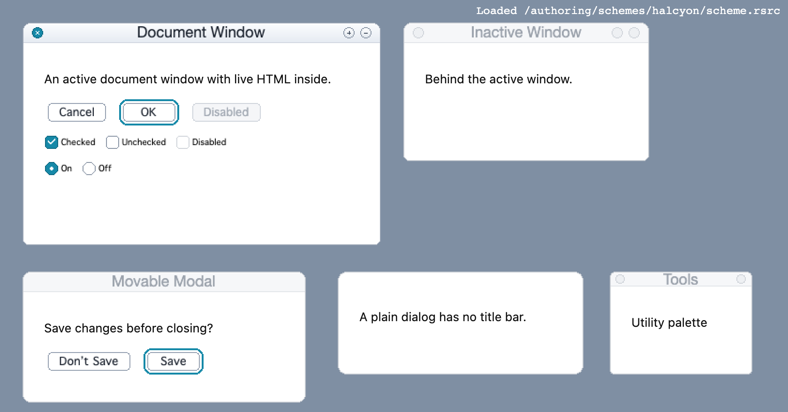
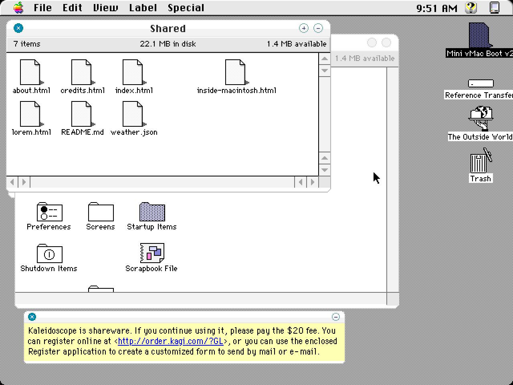

# Authoring a Kaleidoscope scheme in code

*Audience: an engineer new to this repo who wants to make a new theme. No
classic Mac experience needed.*

Most of this repo reads and renders schemes that people made in the 1990s.
This guide covers the opposite direction: writing a new scheme from scratch
with code. The worked example is **Halcyon** (`authoring/schemes/halcyon/`),
a light, frosted, modern-looking scheme made entirely with the tools
described here.



## 1. What you are making

A Kaleidoscope scheme is a single binary file called a **resource fork**. Think
of it as a typed key–value store: every entry has a 4-letter **type**, a
numeric **id**, an optional name, and some bytes.

| Type | What it is | Used for |
|---|---|---|
| `cicn` | a small colour image with a 1-bit transparency mask | window frames, button faces, checkboxes |
| `wnd#` | a window layout recipe | how a frame image stretches to any window size |
| `cinf` | 18 bytes of metadata for one image | button corner sizes, and which pixel holds the text colour |
| `Colr` | scheme-wide flags | not used for rendering today; ship it for completeness |
| `vers` | a version record | shown in the Finder; optional |

The **id** says what an entry is for. For example, `wnd# -14336` is the
document window recipe, and `cicn -10239` is the normal push button face.
Section 6 lists the ids Halcyon uses.

Scriptoscope's runtime loads the file, decodes each entry, and draws windows
and controls from them. Anything the scheme leaves out falls back to a
built-in gray Platinum look.

## 2. Quick start

```sh
npm install
npm run author -- authoring/schemes/halcyon   # writes authoring/schemes/halcyon/scheme.rsrc
npm run dev
# open http://localhost:5173/authoring-preview.html
```

`npm run author` does four things:

1. runs `buildScheme()` from the scheme's `scheme.mjs`, which returns a list of resources;
2. packs them into resource-fork bytes and loads those bytes back through
   **the same converter the browser uses**;
3. runs the authoring checks (section 7) and prints what it found;
4. writes two files, only if there were no errors:
   - `scheme.rsrc`: the raw resource fork, which Scriptoscope loads;
   - `scheme.bin`: the same fork as a **MacBinary** file, for a classic Mac (below).

   On an error the old files are left as they were and the command exits with
   status 1, so a problem shows up here, not later in the browser. Warnings are
   printed but don't stop the build.

If you edit Halcyon itself, rebuild before running `npm test`: tests check
that the committed `scheme.rsrc` and `scheme.bin` match a fresh build.

**Why two files?** On a classic Mac a file has two parts (a data fork and a
resource fork) plus Finder info: a 4-letter file *type* and *creator*. Every
Kaleidoscope scheme has type `Colr` and creator `Acid`, and the resources live
in the resource fork. Modern file systems and git keep only one stream per
file, so `scheme.rsrc` holds just the resource bytes, with no type or creator.
MacBinary packs both forks and the Finder info into one ordinary file.
StuffIt Expander, MacBinary utilities and hfsutils (`hcopy -m`) turn it back
into a real scheme file on a classic Mac or an emulator disk.

Try it: change `accent` in the palette at the top of
`authoring/schemes/halcyon/scheme.mjs`, rebuild, and reload the preview.

To view any other scheme file, use
`authoring-preview.html?scheme=/authoring/schemes/<name>/scheme.rsrc`, or drop
the `.rsrc` file on the "Load your own" tile of the showcase page.

## 3. The toolkit (`tools/theme-author/`)

The authoring toolkit is the write-side twin of `tools/theme-loader/`. Every
encoder is the inverse of a decoder there, and the tests prove the round trip.

| File | What it does |
|---|---|
| `raster.js` | `Raster`: an RGBA drawing surface with `fillRect`, `fillRoundRect`, `clipRounded`, `outlineEdges`, `sprite` (ASCII art), `blit`, `swatch` |
| `encode-cicn.js` | `encodeCicn(raster)`: builds the palette, picks the bit depth, writes mask, B/W fallback and pixels |
| `encode-records.js` | `encodeWnd`, `encodeCinf`, `encodeColr`, `encodeVers` |
| `window-layout.js` | `windowLayout(spec)`: one description gives both the frame geometry and a matching `wnd#` recipe |
| `resource-fork-writer.js` | `writeResourceFork(resources)`: builds the binary file |
| `check-scheme.js` | `checkScheme(resources)`: authoring checks (section 7) |
| `color.js` | colour parsing and the gamma pre-compensation (section 4.4) |

The writers are checked against the real corpus. Re-writing all 18 bundled
schemes with `writeResourceFork` returns every resource byte for byte, and
re-encoding all 3,325 corpus `cicn`s with `encodeCicn` gives identical pixels.

## 4. Four ideas you need

### 4.1 A window is one small image plus a stretching recipe

You never draw a window at its final size. You draw a **template**: the
smallest version of the window, perhaps 80×30 px. The `wnd#` recipe says
which columns and rows may repeat when the window grows.

Each edge (top, bottom, left, right) has a list of **borders**: positions in
the template. Consecutive borders form **cells**, and each cell has a **part
code** that says how it behaves:

```
template top edge:   0        30 31 32 33          81
                     │ fixed  │g │P │g │   fixed    │
part code:              1      11  5  8      1
```

| Part code | Behaviour | Use it for |
|---|---|---|
| 1 | fixed: drawn once, 1:1 | corners and anything containing a widget |
| 8, 11 | grow: the source column repeats (tiles) to fill extra space | plain stretches of border or title bar |
| 5 | title plate: widened to the title's width and centred | the strip behind the title text |
| 6 | title bezel: fixed, hidden when the title doesn't fit | end caps around the plate |
| 0 | collapse: zero width | (rarely needed) |
| 2, 3, 4 | fixed while the window has a close / zoom / collapse box; zero width when it doesn't | space that belongs to that widget |
| 10 | fixed, but dropped when the window is narrower than the template | optional decoration |
| 12 | tile in whole copies only | patterned borders |
| 15, 16, 17 | collapse to zero when their widget is present | never put a widget in these |
| 18 | scale once | rare |

The full table, with the original addresses it was decoded from, is in
[`docs/spec/compositor-spec.md`](./spec/compositor-spec.md).

Cell *i* runs from border *i − 1* to border *i* and takes the part code
stored with border *i*. The first entry's part code is never used; write 0.

> **Rule: start every edge at 0 and end it at the full width or height, with
> corners as explicit code-1 cells.** The cells are only laid out between the
> first and last border; the region before the first border is not a segment
> and is left unpainted (`window-widgets.md` LS9, `src/composeChrome.ts`). Halcyon's
> first build started each recipe after the corner and lost its corners.
> (Older wording in `compositor-spec.md` calls that leading region a "fixed
> corner"; the newer window-widgets rows and the runtime are what you can rely on.)

`windowLayout()` writes recipes that follow every rule here, so you only
choose sizes. It throws a readable error if the sizes can't work: a title bar
under 7px, a side border wider than the fixed corner region, or a widget box
that isn't wholly inside the fixed left or right region of the title bar.

```js
const layout = windowLayout({
  titleBar: 22,        // title bar height
  leftFixed: 30,       // fixed region on the left of the top edge (corner + close box)
  rightFixed: 48,      // fixed region on the right (zoom + collapse + corner)
  bottom: 6,           // frame thickness below the content
  widgets: { close: { x: 10, y: 5, w: 12, h: 12 }, /* zoom, collapse */ },
});
// layout.width, layout.height, layout.content → what to paint
// layout.wnd                                  → pass to encodeWnd()
```

### 4.2 The content area is a hole

The recipe's **part 0 rectangle** marks the content area. The page's real HTML
shows through it, so leave those pixels transparent. Widgets are rectangles
too: part 1 is close, 2 is zoom, 3 is collapse, and 4 is the title rectangle.
Widgets must sit inside fixed cells, or they get stretched.

### 4.3 Some colours live on hidden pixels

The engine doesn't read text colours from a settings field. It reads the
colour of **one chosen pixel of an image**, and it ignores the transparency
mask while doing so. Authors therefore park these colours on pixels that are
invisible on screen:

| Colour | Where the engine reads it |
|---|---|
| window title text | the frame image at the content rectangle's top-left `(content.left, content.top)` |
| title shadow | the pixel to its right; use the same colour for no shadow |
| push button label | the button face at the `cinf`'s `textPixel` |
| push button fill | the button face at the `cinf`'s `bgPixel` |

`raster.swatch(x, y, colour)` writes one of these hidden pixels: stored in the
palette, transparent on screen.

`Raster` coordinates are whole pixels. If you centre something with
`(width - w) / 2`, wrap it in `Math.floor`; a fractional coordinate throws.
Drawing past the edge of the raster is fine (those pixels are dropped), and a
corner radius larger than half the shape is reduced to half.

### 4.4 Type the colour you want to see

Classic Macs displayed colours darker than modern screens (gamma 1.8 against
2.2), so Scriptoscope brightens every stored colour when it loads a scheme.
`encodeCicn` stores the inverse for you, so `'#1d2430'` in your code renders
as `#1d2430` in the browser (measured exactly in Halcyon's title text). Pass
`{ gamma: false }` only if you need raw stored values.

## 5. Walking through Halcyon

`authoring/schemes/halcyon/scheme.mjs` has five numbered sections.

1. **Palette.** Every colour in one object, for active and inactive states.
2. **Window frames.** `windowTypes()` describes eight window types with
   `windowLayout()`. `paintFrame()` paints each one in this order: fill, round
   the corners, outline, punch the content hole, place the title swatches,
   draw the widgets. The inactive frame must be the same size as the active one.
3. **Push buttons.** Three 20×20 faces, each with a **same-id `cinf`**. The
   engine copies the four `cornerSize` corners 1:1, stretches the edges, and
   fills the middle with *one* colour read at `bgPixel`. Gradients inside the
   face are lost, so the face is an outline around a flat fill. The default
   ring is drawn 4px outside the face and *after* it. Only its corners and edge
   bands are drawn, never its middle, but those corner blocks reach in over the
   face's corners. Anything inside the ring line must therefore be transparent,
   or it covers the face. (That was Halcyon's second bug.)
4. **Checkboxes and radios.** 18 images at `id = -9504 + 12·kind + 3·value + tier`.
   Section 6 has the table.
5. **Assemble.** Everything goes into one `resources` array. Resource names
   are optional, but they make the file readable in classic tools such as ResEdit.

## 6. Id cheat-sheet (what Halcyon ships)

| Id(s) | Type | Meaning |
|---|---|---|
| `-14336` | `wnd#` + `cicn` (inactive) / `cicn -14335` (active) | document window |
| `-14332` / `-14331` | same pattern | collapsed (window-shaded) document window |
| `-14328`, `-14326` | | dialog, alert (no title bar) |
| `-14324`, `-14322` | | movable modal, movable alert |
| `-14304`, `-14300` | | titled utility window, and its collapsed form |
| `-10240` / `-10239` / `-10238` | `cicn` + `cinf` | push button: inactive / normal / pressed |
| `-10232` / `-10231` | `cicn` + `cinf` | default-button ring: inactive / normal |
| `-9504 … -9496` | `cicn` | checkbox: value (off, on, mixed) × tier (disabled, normal, pressed) |
| `-9492 … -9484` | `cicn` | radio button, same layout |
| `129` | `Colr` | scheme flags |
| `1` | `vers` | version |

(Value 3, "alternate", would use the next three ids of each kind; Halcyon doesn't ship it.)

Every `wnd#` id N pairs with `cicn` N (inactive) and N + 1 (active). For the
full id vocabulary, see
[`docs/spec/corpus-corroborated-ids.md`](./spec/corpus-corroborated-ids.md)
(names real authors gave each id) and
[`docs/kaleidoscope-asset-catalog.md`](./kaleidoscope-asset-catalog.md).

## 7. What the checks catch

The loader is forgiving because it has to accept 1990s files, so most mistakes
render wrong without failing. `npm run author` runs `checkScheme` to catch the
common ones. Each rule was also run over all 18 corpus schemes; a rule that
fires on an original scheme is at most a warning.

| Severity | Check |
|---|---|
| error | a `wnd#` without its frame image; active and inactive frames of different sizes |
| error | a widget overlapping a cell that stretches or collapses (codes 0, 8, 11–18) |
| error | no content rectangle (part 0), or one that is empty or inside out |
| error | a rect-list rectangle that lies outside the frame image (warning on collapsed windows) |
| warning | a `cicn` whose every pixel is transparent |
| warning | no active frame (`cicn` id + 1), so the inactive frame is used for both states |
| warning | an edge recipe that ends past the edge of the frame image |
| warning | visible pixels outside an edge's recipe span (they are never drawn) |
| warning | an edge with no growing cell (the window can't resize that way) |
| warning | a push face with no same-id `cinf` (the runtime silently draws Platinum instead) |
| warning | a face or ring `cinf` whose sample pixels fall outside its image, or whose `cornerSize` is more than half the image |
| warning | no pressed push face; an incomplete checkbox/radio set |
| warning | a title bar too short for the title (title size is `clamp(content.top − 6, 8, 13)`) |

It also prints the colours the engine *will* sample, such as title text and
button labels, so you can confirm your hidden swatches.

## 8. Not covered yet

Halcyon covers window frames, push buttons, checkboxes and radios. Everything
else falls back to the built-in Platinum look:

- scrollbars, sliders, progress bars, tabs, popup menus, menus, list headers;
- the popup, side-floating and no-title utility window types;
- desktop and folder icons (`ics#`/`ics8`/`icl8`), cursors, sounds;
- background patterns (`ppat`). The window body is plain white by default; to
  tint it, ship an 8×8 `ppat` and point `cinf -9551`'s `bgPatternId` at it.
  There is no `ppat` encoder yet.

Each of these is documented from the reading side under `docs/spec/`. Adding
one usually means an encoder (if the type is new), a painting function, and a
checker rule, following the same pattern.

## 8a. Testing in real Kaleidoscope

Halcyon has been loaded in the original Kaleidoscope 2.3.1 on System 7.5.5
(screenshots and notes: [`authoring/schemes/halcyon/classic/`](../authoring/schemes/halcyon/classic/)).
It loaded on the first boot with no errors, and its frames, widgets, default
ring and checkboxes were drawn by the original engine.



Maintainers with the private reference emulator
([`maintainer-reference-environment.md`](./maintainer-reference-environment.md))
can repeat it:

1. Make fresh copies of the known-working system and transfer seeds (never boot the originals).
2. Copy the scheme onto the system disk with hfsutils, which unpacks MacBinary:
   `HOME=<scratch> hcopy -m scheme.bin :Halcyon`. Setting `HOME` keeps hfsutils'
   mount state out of your real home directory. Confirm type `Colr` / creator `Acid` with `hls -l`.
3. Boot with sound off, open the Kaleidoscope control panel, click **Select
   Scheme…**, pick the file, and click **Open**.

What real Kaleidoscope showed that the web preview doesn't:

- Halcyon has a blank icon in the scheme picker, and the panel greys out
  Finder Icons, Arrow Cursor, WindowShade Sounds, Finder Colors, Desktop
  Pattern, Accent Color and About This Scheme. The scheme ships none of them.
- Menus, scrollbars and the desktop stay on the system defaults.
- A plain dialog or alert body is the system dialog grey (`#E7E7E7`) under the
  frame's white top band; Scriptoscope's web runtime fills it white. That is
  a runtime fidelity finding, not an authoring bug.
- The title is drawn in bitmap Chicago 12, and the 8 bpp screen palette
  turns the title-bar gradient into flat bands.

## 9. Getting help from an AI assistant

[`authoring-with-agy.md`](./authoring-with-agy.md) records an experiment with
Google's Antigravity CLI. In short: ask for `Raster` code or ASCII sprite rows
with a JSON schema; image generation gives the wrong size and format.

## 10. Where the rules come from

- [`spec/compositor-spec.md`](./spec/compositor-spec.md): recipes, part codes, how cells grow.
- [`spec/engine/window-widgets.md`](./spec/engine/window-widgets.md): rows TC1–TC5 (title colour) and LS9 (nothing is painted outside the recipe).
- [`spec/engine/push-button.md`](./spec/engine/push-button.md) and [`spec/control-face-geometry.md`](./spec/control-face-geometry.md): button faces and rings.
- [`spec/checkable-icons.md`](./spec/checkable-icons.md): checkbox and radio ids.
- [`spec/cinf-environment.md`](./spec/cinf-environment.md) and `tools/theme-loader/decoders/*.js`: byte layouts.
