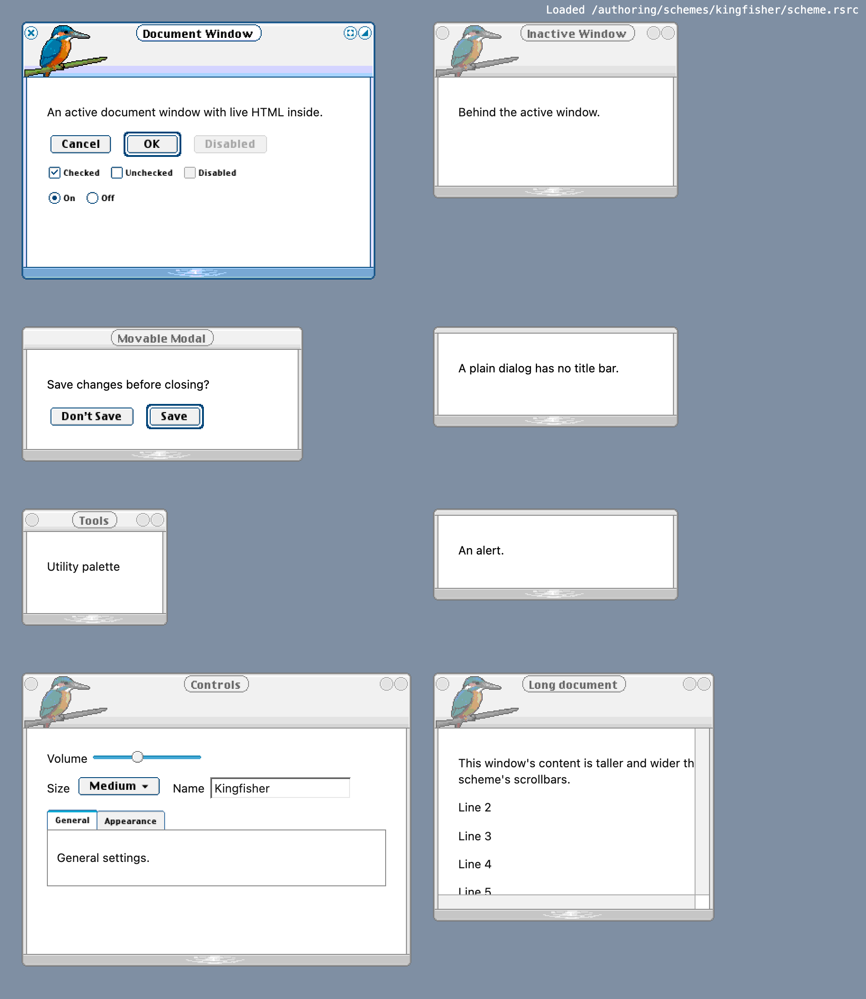

# Authoring a Kaleidoscope scheme in code

*Audience: an engineer new to this repo who wants to make a new scheme. No
classic Mac experience needed. Start here; the other authoring docs are
references this guide links to.*

Most of this repo reads and renders schemes that people made in the 1990s.
This guide covers the opposite direction: writing a new scheme from scratch
with code. There are five first-party examples in `authoring/schemes/`, all
made with the tools described here:

| Scheme | Folder | Look at it for |
|---|---|---|
| Kingfisher | `kingfisher/` | the main worked example: a kingfisher on a frosted window; control families in `parts/`, one file each |
| Castle | `castle/` | towers above the title bar, whole merlons, stone drawn on a measured grid |
| Brickworks | `brickworks/` | whole studs (`13 \| 12 \| 13`), a centred ornament on untitled windows |
| Bonn | `bonn/` | landmarks on the moving title caps, a centred bridge, and the title-space cost of ornaments |
| Midnight 2027 | `new-year-2027/` | fireworks and numerals that drop whole on narrow windows |



**The authoring docs:**

| Doc | Use it for |
|---|---|
| this guide | the workflow, the core ideas, the toolkit, ids and checks |
| [`authoring-exotic-frames.md`](./authoring-exotic-frames.md) | rules R1–R30: how frame recipes behave, with corpus precedents. Look things up there while you build frames |
| [`authoring-visual-design.md`](./authoring-visual-design.md) | pixel-art and design guidance, and the review checklist for a scheme PR |
| [`authoring-art-with-ai.md`](./authoring-art-with-ai.md) | which AI tools work for concept images and small sprites, and how to run them |
| [`authoring/README.md`](../authoring/README.md) | what each scheme folder holds |

**Terms used in all of them.** A *scheme* is one Kaleidoscope file (the
corpus in `themes/` calls its folders theme bundles; an authored scheme is not
one). *Web* means Scriptoscope's runtime; *classic* means the original
Kaleidoscope 2.3.1 on a classic Mac. A *code* (code 1, code 10) is the
behaviour of one recipe cell (§3.1); *rect N* is entry N of a window's
rectangle list (§3.2).

## 1. What you are making

A Kaleidoscope scheme is a single binary file called a **resource fork**. Think
of it as a typed key–value store: every entry has a 4-letter **type**, a
numeric **id**, an optional name, and some bytes.

| Type | What it is | Used for |
|---|---|---|
| `cicn` | a small colour image with a 1-bit transparency mask | window frames, button faces, checkboxes |
| `wnd#` | a window layout recipe | how a frame image stretches to any window size |
| `cinf` | 18 bytes of metadata for one image | button corner sizes, and which pixel holds the text colour |
| `ppat` | a tiling colour pattern | the desktop, window bodies, progress stripes |
| `Colr` | scheme-wide flags | not used for rendering today; ship it for completeness |
| `vers` | a version record | shown in the Finder; optional |

The **id** says what an entry is for. For example, `wnd# -14336` is the
document window recipe, and `cicn -10239` is the normal push button face.
§7 lists the ids the first-party schemes use.

Scriptoscope's runtime loads the file, decodes each entry, and draws windows
and controls from them. Anything the scheme leaves out falls back to a
built-in gray Platinum look.

## 2. Quick start

```sh
npm install
npm run author -- authoring/schemes/kingfisher   # writes authoring/schemes/kingfisher/scheme.rsrc and scheme.bin
npm run dev
# open http://localhost:5173/authoring-preview.html
```

`npm run author` does four things:

1. runs `buildScheme()` from the scheme's `scheme.mjs`, which returns a list of resources;
2. packs them into resource-fork bytes and loads those bytes back through
   **the same converter the browser uses**;
3. runs the authoring checks (§8) and prints what it found;
4. writes two files, only if there were no errors:
   - `scheme.rsrc`: the raw resource fork, which Scriptoscope loads;
   - `scheme.bin`: the same fork as a **MacBinary** file, for a classic Mac (below).

On an error the old files are left as they were and the command exits with
status 1, so a problem shows up here, not later in the browser. Warnings are
printed but don't stop the build.

**Why two files?** On a classic Mac a file has two parts (a data fork and a
resource fork) plus Finder info: a 4-letter file *type* and *creator*. Every
Kaleidoscope scheme has type `Colr` and creator `Acid`, and the resources live
in the resource fork. Every corpus scheme file also has the Finder's
"custom icon" flag set, so it shows its own icon family (`-16455`, the picker
icon); `scheme.bin` sets it too. Git keeps only one stream per file, so `scheme.rsrc`
holds just the resource bytes. MacBinary packs both forks and the Finder info
into one ordinary file, which StuffIt Expander, MacBinary utilities and
hfsutils (`hcopy -m`) turn back into a real scheme file.

If you edit a first-party scheme, rebuild it before running `npm test`: tests
check that the committed `scheme.rsrc` matches a fresh build (`scheme.bin` is
generated for emulator use and untracked in git to keep the repository small).
You can also run `npm run check:schemes` to validate all five authored schemes
at once (rebuilding, convertChrome reload, authoring checks, byte comparison
and MacBinary round-tripping).

Try it: change a colour in `authoring/schemes/kingfisher/palette.mjs`, rebuild,
and reload the preview.

For a new scheme, copy an example to `authoring/schemes/<slug>/`, update its
`meta.json`, version/about strings and palette, then simplify its frame to a
buildable skeleton. Start its `concept/brief.md` from the brief template.
Keep the initial inherited art clearly marked until it is replaced; do not
start a second theme catalog or duplicate the shared validation suite.

To view any other scheme file, use
`authoring-preview.html?scheme=/authoring/schemes/<name>/scheme.rsrc`, or drop
the `.rsrc` file on the "Load your own" tile of the showcase page.

## 3. Five ideas you need

### 3.1 A window is one small image plus a stretching recipe

You never draw a window at its final size. You draw a **template**: the
smallest version of the window, perhaps 230×140 px for a decorated frame. The
`wnd#` recipe says which columns and rows may repeat when the window grows.

Each edge (top, bottom, left, right) has a list of **borders**: positions in
the template. Consecutive borders form **cells**, and each cell has a **code**
that says how it behaves:

```
template top edge:   0        30 31 32 33          81
                     │ fixed  │g │P │g │   fixed    │
code:                   1      11  5  8      1
```

| Code | Behaviour | Use it for |
|---|---|---|
| 1 | fixed: drawn once, 1:1 | corners and anything containing a widget |
| 8, 11 | grow: the cell's source repeats (tiles) to fill extra space; 11 tiles from the far end | plain stretches of border or title bar |
| 5 | title plate: widened to the title's width and centred | the strip behind the title text |
| 6 | title bezel: fixed, hidden when there is no title | end caps around the plate |
| 0 | collapse: zero width | skipping template columns on one edge, e.g. a bottom with less art than the top |
| 2, 3, 4 | fixed while the window has a close / zoom / collapse box; zero width when it doesn't | space that belongs to that widget |
| 10 | fixed, but dropped (with the title) when the window is narrower than the edge's fixed cells | an ornament that may disappear on small windows |
| 12 | tile in whole copies only; the leftover pixels go to a 13/14 (or 8/11) cell in the same half | patterned borders: merlons, studs |
| 13, 14 | filler: gets only the leftover pixels, so it is 0 px at template size | the gap next to a code-12 run |
| 15, 16, 17 | collapse to zero when their widget is present | never put a widget in these |
| 18 | scale once | rare |

Cell *i* runs from border *i − 1* to border *i* and takes the code stored
with border *i*. The first entry's code is never used; write 0.

> **Rule: start every edge at 0 and end it at the full width or height, with
> corners as explicit code-1 cells.** Only the region between the first and
> last border is painted ([R1](./authoring-exotic-frames.md#1-cell-codes-rules-r1r12)).
> Kingfisher's first build started each recipe after the corner and lost its corners.

Build the recipes with **`frameLayout()`**: you list the cells of each edge
(`{ code, w, name }`), and it returns the template size, the content rect, the
`wnd#` and the position of every named cell to paint by. It refuses layouts
the engine would draw wrong. The API and its checks are in
[exotic frames §8](./authoring-exotic-frames.md#8-framelayout-and-windowlayout),
and every first-party `frames.mjs` writes its recipes one line per edge in its
header comment, which is the easiest way to read them. For a plain rounded
rectangle, `windowLayout()` is shorter: you give the bar height, the fixed
regions and the widget boxes.

Which code gives which effect (whole merlons, a centred crest, a draw-once
skyline) is the table after R8 in
[`authoring-exotic-frames.md`](./authoring-exotic-frames.md).

### 3.2 The content area is a hole

Each `wnd#` also has a list of rectangles. **Rect 0** marks the content area.
The page's real HTML shows through it, so leave those pixels transparent.
Widgets are rectangles too: rect 1 is close, 2 is zoom, 3 is collapse, and 4
is the title rectangle. Widgets must sit inside fixed cells, or they get
stretched.

### 3.3 Some colours live on hidden pixels

The engine doesn't read text colours from a settings field. It reads the
colour of **one chosen pixel of an image**, and it ignores the transparency
mask while doing so. Authors therefore park these colours on pixels that are
invisible on screen:

| Colour | Where the engine reads it |
|---|---|
| window title text | the frame image at the content rectangle's top-left `(content.left, content.top)` |
| title shadow | the pixel to its right; use the same colour for no shadow |
| push button label | the button face at the `cinf`'s `textPixel` |
| push button fill | the button face at the `cinf`'s `bgPixel` |

`raster.swatch(x, y, colour)` writes one of these hidden pixels: stored in the
palette, transparent on screen.

`Raster` coordinates are whole pixels. If you centre something with
`(width - w) / 2`, wrap it in `Math.floor`; a fractional coordinate throws.
Drawing past the edge of the raster is fine (those pixels are dropped), and a
corner radius larger than half the shape is reduced to half.

### 3.4 Type the colour you want to see

Classic Macs displayed colours darker than modern screens (gamma 1.8 against
2.2), so Scriptoscope brightens every stored colour when it loads a scheme.
`encodeCicn` stores the inverse for you, so a colour typed in your code renders
as that colour in the browser. Pass `{ gamma: false }` only if you need raw
stored values.

For procedural surfaces and controls, prefer the 8-bit system palette (`SYSTEM_PALETTE_256`,
exported from the toolkit): the 6×6×6 cube (`00 33 66 99 cc ff` per channel)
plus the grey ramp. Then an 8 bpp classic screen picks the colour you meant
instead of a neighbour of a different hue. The schemes write these colours in
one of two ways; pick one per scheme and say which in `palette.mjs`'s header:

- **`sys('#336699')`** (Kingfisher): returns the colour the loader shows for that
  stored entry, so web and classic show exactly the same colour.
- **Plain cube hex** (Castle, Brickworks, Midnight 2027, Bonn's procedural art): the encoder
  pre-compensates it, and an 8 bpp screen snaps it back to the same entry. The
  classic screen then shows it a little brighter than the web
  (`#993333` → `#a84444`), but never a different hue.

Extracted illustrations may use a bounded source-derived palette to preserve
shading and character, as Bonn's PNGs do. Review the complete frame through
the 8-bit simulation and native engine: source colours can merge or shift.
Keep desktop patterns on exact system-palette entries.

`npm run author -- <dir> --palette` lists each colour's 8-bit entry and flags
any that drift or collapse onto one entry (§4.5).

### 3.5 Smooth edges, dithering and the colour budget

The mask is binary. Smooth-shape helpers blend edge colours against opaque
pixels or an explicit `matte`; without a matte, transparent edges stay hard.
Use smooth curves against known surfaces, not thin glyphs or window edges
that may sit over any desktop. Add hidden swatches after painting.
This is a limitation of the scheme's `cicn` mask, not all classic Mac graphics:
QuickDraw supported deep-mask blending from System 7 ([Apple's technical
journal, p.26](https://vintageapple.org/develop/pdf/develop-06_9104_Spring_1991.pdf)).
That does not add partial alpha to a Kaleidoscope window-frame resource.

`ditheredGradient` mixes a few colours with a 4×4 pattern. The repeat must
wrap at the tile boundary: never dither across a 1px growing cell, since its
repeated column becomes stripes. Use one colour per row there. Title plates
should also be seamless at partial final tiles; multi-pixel motifs need an
explicit `tiled` plate and linted title rows. Patterns (`ppat`) repeat both ways.

A `cicn` holds at most 256 colours. Smooth blends can exceed that quickly;
flat system-palette ramps keep the budget predictable. `fitPalette(raster)`
merges rare colours while preserving hidden swatches, and rejects impossible
protected-colour limits. Inspect the result: an automatic merge may remove a
one-pixel highlight. See [visual design §2](./authoring-visual-design.md#2-pixel-ui-guidance-for-this-format)
for outline, contrast and texture rules.

## 4. The workflow

Design the whole window before detailing individual cells. Structural checks
and visual review answer different questions; both are part of this workflow.

| Step | You produce | Command |
|---|---|---|
| 1. Brief and skeleton | `concept/brief.md`, a buildable frame recipe and geometry sheet | `node scripts/authoring-concept.mjs` |
| 2. Concept image | `concept/concept.jpg` | an image model ([AI routes](./authoring-art-with-ai.md#3-the-image-route)) |
| 3. Extraction | 1× rasters of the key ornaments, with reproducible crops and masks | `npm run paint-over` or a recorded extraction script |
| 4. Clean-up | editable 1× PNG illustrations; frame geometry and repeating surfaces in code | |
| 5. Build and check | `scheme.rsrc`, `scheme.bin` | `npm run author` (`--sheet`, `--palette`) |
| 6. Preview and capture | `preview.png`, `preview-sizes.png` | `npm run dev`, `npm run capture:authoring` |
| 7. 8-bit check | a simulated classic screenshot | `npm run sim8` |
| 8. Classic extras | about box, cursor, sounds included in the build | `classic.mjs` (§4.9) |
| 9. Real Kaleidoscope | captures of the exact frozen build, hashes and observations | the maintainers' emulator (§4.8) |

Repeat the affected build, preview and 8-bit checks after art changes. Include
the classic extras before freezing the build for the VM. A later byte change
makes earlier VM screenshots historical; test the revised file again before
calling that revision classic-tested.

### 4.1 Write the brief

`concept/brief.md` is the art direction. Start with the
[brief template](../authoring/concept-brief-template.md); the existing schemes'
briefs also preserve historical plans, which may differ from their current recipes:

Record the signature silhouette, materials, lighting and active/inactive
palette. Map concept features to measured cells and reserve room for a
representative title. Save the selected concept, prompt, crop and measured
scale so another author can reproduce the translation.

Keep the image prompt in `concept/brief-*.txt`, so a retry is one command.
Separate the original target, the current implementation and deliberate
departures. Record measured title room and ornament behavior from the built
recipe; a concept prompt is not evidence of how the engine drops or tiles art.
What makes a good brief (numeric targets, calm bodies, the title-room budget)
is in [visual design §3](./authoring-visual-design.md#3-designing-from-a-concept).

### 4.2 Make the concept image

Set the frame geometry before asking for art. Once a skeleton scheme builds,
generate its source-template sheet:

```sh
node scripts/authoring-concept.mjs authoring/schemes/<name> --out /tmp/concept-review.html
```

This writes a self-contained HTML reference and a sibling `*-template.svg`,
drawn from the document window's actual `wnd#` and frame dimensions. Attach
the SVG to the concept brief: fixed cells carry the silhouettes, growing
cells must repeat cleanly, and the dashed title/widget boxes must stay usable.
The sheet shows source-art coordinates, before the engine stretches them;
it is a geometry constraint, not a prediction of the final window width.
The skeleton is provisional: enlarge bands, ornaments and control art when
the measured concept needs it. Do not shrink the concept into an inherited
thin frame just to keep old source dimensions or tests unchanged.

An image model renders the finished window as a mockup, saved as
`concept/concept.jpg`. [`authoring-art-with-ai.md`](./authoring-art-with-ai.md#3-the-image-route)
describes the available routes and their limits.

The concept supplies the composition and source illustrations. Prepare its
pixels for the target grid, palette and binary mask before importing them:
the raw mockup may contain soft edges, JPEG noise or a painted background.

### 4.3 Paint over the concept

Redrawing ornaments from the concept by eye keeps the motifs and loses the
pose and proportions. Instead, extract the concept back to 1×. Use the scheme
palette when it preserves the artwork; a source-derived palette can retain
more of its shading, within the resource's colour budget. Bonn's recorded
extraction uses grid-center samples and explicit background masks for this
reason. The general paint-over tool offers a palette-voting route:

1. **Measure the scale**: how many concept pixels make one art pixel. Use the
   outline width or a widget's diameter. The concepts so far were 2.5×
   (Brickworks), 3× (Kingfisher, Castle, Bonn) and 3.7× (Midnight 2027).
2. **Convert the JPEG to PNG** (`sips -s format png concept.jpg --out /tmp/concept.png`
   on macOS, or `magick concept.jpg /tmp/concept.png`).
3. **Run the paint-over** on one region at a time:

   ```sh
   npm run paint-over -- /tmp/concept.png --crop 40,10,300,190 --scale 3 \
     --palette authoring/schemes/kingfisher/palette.mjs --key '#c8d4e4' --out /tmp/bird.png
   ```

   Each output pixel takes the most common palette colour in its
   scale × scale block (`--method mode`, the default), so 1 px outlines
   survive. `--method mean` averages first, for soft areas. `--key` turns the
   concept's backdrop transparent. It writes the 1× PNG and an 8× zoom to look
   at; `--emit` also prints the result as code you can paste.

It works best on outlined shapes: birds, buildings, towers, buttons, widgets.
Thin detail loses the vote (Castle's 1 px mortar lines and Midnight 2027's
firework rays came out as noise). For those, use the paint-over to measure
size, count and colour, then redraw them.

### 4.4 Clean up by hand

When the concept already contains the illustration you want, extract that
art first. Do not replace it with a procedural approximation just because
the subject can be described as rectangles or circles. Bonn's building,
blossom and bridge assets show reproducible crops, traced background masks
and source-derived palettes in `concept/extract-assets.mjs` and `sprites/`.

Keep detailed illustrations as editable transparent 1× PNGs (Kingfisher's
`parts/sprites/` is an example), small glyphs as short grids if useful, and
repeating materials and frame geometry in code. Import PNGs with `decodePng`
and `Raster.fromRgba`; reject a nonzero returned `snapped` count, keep paired states the same size,
and add hidden colour swatches in the frame painter after import. Typical clean-up:

- repair the mask and background contamination while retaining intentional outlines;
- vote out JPEG speckles; fill back anything the `--key` removed by mistake;
- draw single-pixel sparks and stars *after* any outline pass, or the outline
  pass turns them into outline colour;
- redraw stone and brick procedurally on the concept's measured block grid,
  so they tile;
- check the art against [visual design §2](./authoring-visual-design.md#2-pixel-ui-guidance-for-this-format):
  one light direction, whole-pixel glyphs, short ramps.

Make one visual change per comparison: silhouette or spacing first, then
surface contrast, then fine detail. Reject a technically valid pass if it
loses the concept's defining material or silhouette. Reducing saturation
alone does not make glass, and removing every joint does not make better stone.

Then fit the art to the cells in the brief. Call `layout.lint(raster)` after
painting each frame: it catches stray art in tiled cells, the bug every
builder hit at least once ([R8, exotic frames §8](./authoring-exotic-frames.md#8-framelayout-and-windowlayout)).

### 4.5 Build and check

```sh
npm run author -- authoring/schemes/<name>
```

Read the whole output, not just the exit code:

- the window types and the number of images;
- for each titled window, the title colour the engine *will* sample and its
  contrast on the bar; the same for push button labels. This confirms your
  hidden swatches without a browser;
- warnings (§8);
- a **classic extras** line: what real Kaleidoscope will show beyond the
  windows (step 8).

Two flags add review aids, written even when the checks fail:

- `--sheet` writes `<dir>/sheet.png`: every `cicn` (and every `ppat`, tiled
  2×2) at 4× on a checkerboard, grouped by family and labelled with id and
  size, with the same images through the 8-bit simulation beside them. It is
  gitignored; don't commit it.
- `--palette` prints the palette report for `<dir>/palette.mjs`: each
  colour's 8-bit entry and distance, `COLLAPSE` when different colours share
  an entry, and WCAG contrast (on screen, and after the 8-bit snap) for the
  title and button colours the engine samples, plus any pairs the palette
  exports as `CONTRAST = [[fg, bg, 'label', floor?], …]`. The floor comes
  from the label (`title`, `inactive title`, `label`, `outline`, `glyph`,
  else 4.5); the floors themselves are in
  [visual design §2.3](./authoring-visual-design.md#23-palette-construction).

### 4.6 Preview and capture

With `npm run dev` running, open
`http://localhost:5173/authoring-preview.html?scheme=/authoring/schemes/<name>/scheme.rsrc`.
It shows every window type the scheme defines, plus push buttons, checkboxes,
sliders, popup menus, text fields, tabs and scrollbars. Reload after each
rebuild.

- `&layout=/authoring/preview-layouts/sizes.html` swaps in the stress layout:
  narrow and wide windows, long titles, an active scroller. Check it after
  every tile change: big windows turn any 1 px feature per tile into a dotted
  line, and narrow windows show what the frame sheds first.
- `&active=<title or window type>` makes that window active (`&active=dialog`
  for untitled windows).
- Click a window body to activate it, double-click a title bar to see the
  collapsed frame, and hold the mouse down on a widget to see its pressed art.
- The default layout omits progress; `--concept` includes it. Menus and the
  desktop pattern need classic review (§9).

The concepts were drawn at about 3×, so a 1× preview next to one always looks
thinner. Compare at the same scale before deciding a pass is under-scaled.

For a composition review, capture just one active document window at DPR 1
and compare it with a crop of the concept's corresponding window:

```sh
npm run capture:authoring -- authoring/schemes/kingfisher --document --out /tmp/document.png
node scripts/authoring-concept.mjs authoring/schemes/kingfisher \
  --render /tmp/document.png --crop 182,162,773,532 --out /tmp/concept-review.html
```

Open `/tmp/concept-review.html` directly in a browser; all images are embedded.
`--crop` is `x,y,width,height` in the original concept image, including the
whole outer frame. The two windows share a displayed outer width and retain
their own aspect ratios, so height differences remain visible. `--scale 2`
is the default display enlargement. Capture options `--width 380 --height 210`
set **content** pixels; the PNG includes the full outer chrome. The comparison
script's `--concept <path>` selects a different PNG or JPEG than `concept/concept.jpg`.
These review files are temporary; keep the brief and finished captures in git.

Use the capture command's `--concept` instead of `--document` for a fuller scene: live checkboxes,
radios and action buttons, a progress bar composed from the scheme, and active
scrollbars. This exposes missing material/scale across control families that
a mostly empty document hides. It uses the same content-size options.

When it looks right, capture the committed previews:

```sh
npm run capture:authoring -- authoring/schemes/<name>   # needs npm run dev; --base for another port
```

It writes `preview.png` (a flowing overview at DPR 2, full height at a 960px
viewport width) and `preview-sizes.png` (the fixed stress layout at DPR 1).
The overview loads the bundled classic-style fonts before drawing canvas
text and lets tall frames determine row heights. Use the single-window
comparison for composition judgments rather than comparing overview heights.

### 4.7 Check it at 8 bits

```sh
npm run sim8 -- authoring/schemes/<name>/preview.png /tmp/<name>-sim8.png --dpr 2 --zoom 2
```

This maps every pixel to the system palette the way an 8 bpp classic screen
does: it undoes the display gamma, picks the palette entry for the stored
value (each channel cut to 4 bits, then the nearest entry, like the Color
Manager's inverse table), and shows it through the gamma again, so the output
sits next to the web preview. `--dpr 2` reads a DPR-2 preview; `--capture`
shows entries at the levels the committed `classic/*.png` captures use;
`--exact` uses the plain nearest entry instead. Against the real classic
captures it picked the same entry for 92% of frame pixels, and it reproduced
every colour problem the first real boots found (pink "warm grey" stone,
striped dithered water). It is a review tool, not fidelity evidence.

Fix collapsed ramps and colour shifts here: the real-Kaleidoscope boot is
expensive and should confirm, not discover.

### 4.8 Test in real Kaleidoscope

All five first-party schemes have been loaded in the original Kaleidoscope
2.3.1 on System 7.5.5. Each `classic/README.md` identifies which revision its
captures show; it must not imply a later art revision was tested.
For substantially larger or novel frame recipes, run an early native smoke
test before polishing every family, then repeat on the frozen final build.


Maintainers with the private reference emulator
([`maintainer-reference-environment.md`](./maintainer-reference-environment.md))
can repeat it:

1. Finish browser and 8-bit review first. Build every candidate with
   `npm run author -- <dir>` and run `npm run check:schemes`. Record SHA-256
   hashes of both `scheme.rsrc` and `scheme.bin`; stage that exact batch for the VM.
2. Make fresh copies of the known-working system and transfer seeds. Keep
   private ROM/system bytes outside this repository. Use one owned emulator
   session and isolated HFS mount state; never mount a disk while it is running
   in the emulator, and never boot the immutable seeds.
3. Copy the MacBinary files to the stopped transfer-disk copy with the
   maintainer toolkit's isolated hfsutils wrapper (`hcopy -m`), then unmount
   before boot. Confirm Finder type `Colr`, creator `Acid` and the custom-icon
   flag. The system seed has little free space; use the transfer disk for a batch.
4. Boot System 7.5.5 / Kaleidoscope 2.3.1 at the recorded depth, normally 8 bpp,
   with sound off for this WASM build. Open the control panel and use **Select
   Scheme…** → **Open** for each candidate. Select the scheme before launching
   any native test fixture; do not switch schemes while that fixture is running.
5. Check an ordinary and narrow document, active/inactive appearance, a dialog,
   pressed widgets and a collapsed window. Inspect menus, picker icon, About
   text and cursor against the desktop. Record what was actually exercised;
   sound-off runs do not verify audible WindowShade sounds.
6. Capture the relevant views and record the date, environment, staged hashes,
   selection/load outcome and visible issues in `classic/README.md`. Preserve
   older captures as history. Stop the owned VM before any HFS inspection.

Batch several frozen schemes into one prepared transfer disk, but record a
separate outcome for each. If a failure requires a fix, rebuild and re-test
that scheme's new hash. These are visual compatibility checks, not automatic
admission into the original-reference corpus or permission to refresh goldens.

Prefer compact source templates over copying long regions that will repeat.
The larger Bonn revision passed browser/authoring checks but produced a native
system error; shortening its canopy repeat preserved the visible dimensions
and loaded successfully. This is an observed compatibility result, not proof
of a universal resource-size limit. Preserve failed builds and change one
factor at a time when diagnosing native-only failures.

What classic shows differently, and what the tall frames taught, is in
[R16](./authoring-exotic-frames.md#2-art-outside-the-body--irregular-silhouettes-r13r19).
In short: the title is bitmap Chicago 12, so title plates are narrower; art
above the title bar goes under the menu bar when a window sits at the top of
the screen; clicks pass through transparent frame pixels; and subtle colours
shift at 8 bpp.

### 4.9 Add the classic extras

Kaleidoscope's control panel greys out each "Use This Scheme's" option unless
the scheme ships what it needs (§7.2). `tools/theme-author/classic-extras.js`
builds them, so a scheme's `classic.mjs` is three calls: `aboutBox` (the About
This Scheme dialog and the panel's name and description), `arrowCursors` and
`shadeSounds` (WindowShade sounds from the small synthesizer in
`encode-snd.js`). Copy any first-party `classic.mjs`.

The panel draws the about box's text in its small application font (Geneva 9
on the System 7.5.5 reference, 13 px lines), not Chicago 12, so `aboutBox`
wraps the text itself and sizes the dialog to the lines, with 16 px margins.
The icon can be the 32×32 picker icon or larger art up to 64×64 (Bonn's
40×48 Beethoven bust); the text moves right to make room.

Keep the cursor's fill and edge far apart in value and test it on the scheme's
own desktop pattern: Bonn's first cursor, teal on a teal desktop, all but
vanished in real Kaleidoscope. The web runtime draws none of these extras.

## 5. The toolkit (`tools/theme-author/`)

The authoring toolkit is the write-side twin of `tools/theme-loader/`. Every
encoder is the inverse of a decoder there, and the tests prove the round trip.

| File | What it does |
|---|---|
| `raster.js` | `Raster`: an RGBA drawing surface with `fillRect`, `fillRoundRect`, `clipRounded`, `sprite` (ASCII art), `blit`, `swatch`, `outlineEdges` (outline a whole silhouette), the smooth shapes (§3.5) and `Raster.fromRgba` for imported art; plus `verticalGradient`, `ditheredGradient` and `bayer` |
| `fit-palette.js` | `fitPalette(raster)`: merges the rarest colours until an image fits the 256-colour limit, keeping hidden swatches exact; `colorCount(raster)` |
| `frame-layout.js` | `frameLayout(spec)`: per-edge cell lists, named cells, `lint`, `minWidthForTitle`; `stripLayout` and `pressedStripFrom` for the pressed-widget strip ([exotic frames §8](./authoring-exotic-frames.md#8-framelayout-and-windowlayout)) |
| `window-layout.js` | `windowLayout(spec)`: frame geometry and a matching `wnd#` for a plain rounded frame |
| `encode-cicn.js` | `encodeCicn(raster)`: builds the palette, picks the bit depth, writes mask, B/W fallback and pixels |
| `encode-ppat.js` | `encodePpat(raster)`: tiling patterns (desktop, window bodies, progress stripes) |
| `encode-records.js` | `encodeWnd`, `encodeCinf`, `encodeColr`, `encodeVers` |
| `encode-icons.js` | `encodeIconFamily`, `encodeIconPlane`, `encodeIconList`: Finder-style icons (`ICN#`, `icl8`, `icl4`, `ics#`, `ics8`, `ics4`) in the system palettes; `SYSTEM_PALETTE_256` |
| `encode-clut.js` | `encodeClut`, `encodeHeaderClut`: colour tables, e.g. the window header colours |
| `encode-strings.js` | `encodeStrList` (`STR#`), `toMacRoman`, `pascalString` |
| `encode-dialog.js` | `encodeDlog`, `encodeDitl`: dialog templates (the about box) |
| `encode-crsr.js` | `encodeCrsr`: a 16×16 colour cursor from a raster |
| `encode-snd.js` | `encodeSnd`: an 8-bit sampled `snd `; `synthesize`: a small deterministic synthesizer for original sounds |
| `classic-extras.js` | `aboutBox`, `arrowCursors`, `shadeSounds`: the control-panel extras in one call each (§4.9) |
| `macbinary.js` | `writeMacBinary`: packs the fork with type `Colr` / creator `Acid` and the custom-icon Finder flag for a classic Mac (§2) |
| `resource-fork-writer.js` | `writeResourceFork(resources)`: builds the binary file |
| `check-scheme.js` | `checkScheme(resources)`: the authoring checks (§8) |
| `color.js` | colour parsing and the gamma pre-compensation (§3.4) |
| `paint-over.js` | `paintOver(image, options)`: the engine behind `npm run paint-over` (§4.3) |
| `sim8.js` | `simulate8bit(image)`: the engine behind `npm run sim8` (§4.7); `systemEntryFor(colour)` for one colour |
| `palette-report.js` | `paletteReport(palette, { pairs })`: the report behind `--palette`; `contrastRatio` |
| `contact-sheet.js` | `contactSheet(resources, { sim8 })`: the image behind `--sheet` |

The writers are checked against the real corpus. Re-writing all 18 bundled
schemes with `writeResourceFork` returns every resource byte for byte, and
re-encoding all 3,325 corpus `cicn`s with `encodeCicn` gives identical pixels.
The same holds for all 217 indexed corpus `ppat`s, 4,937 colour icon planes,
2,803 black-and-white icon planes and 60 `clut`s, and for every corpus
`STR#`, about-box `DLOG`/`DITL`, `crsr` and standard-header format-1 `snd `
(`encode-classic.test.mjs`).

To bring in sprites drawn in another tool, read the PNG with
`scripts/lib/png-decode.mjs` and wrap it with `Raster.fromRgba()`. It snaps
alpha to 0 or 255, because the encoder treats alpha 1–127 as a hidden swatch.

## 6. Control families

Frames are the hard part; controls are mostly about rules the engine applies
to every scheme. Kingfisher has every family, so this section follows it.

### 6.1 Push buttons and the default ring

Three faces (inactive `-10240`, normal `-10239`, pressed `-10238`), each with a
**same-id `cinf`**. Without the `cinf`, the runtime silently draws Platinum
instead. The engine copies the four `cornerSize` corners 1:1, draws the
edge bands, and fills the middle with *one* colour read at `bgPixel`.
`cinf.tileSides` chooses repeated rather than stretched edges. For a repeated
stud row, the source middle width is the repeat period; Brickworks uses an
8px period. Check short, long, default and pressed buttons in both renderers.
Gradients inside the face are lost.

The default ring (`-10232` inactive, `-10231` normal) is drawn 4 px outside
the face and *after* it. Only its corners and edge bands are drawn, never its
middle, but those corner blocks reach in over the face's corners. Anything
inside the ring line must therefore be transparent, or it covers the face.

### 6.2 Checkboxes and radio buttons

18 images at `id = -9504 + 12·kind + 3·value + tier`: kind 0 checkbox, 1
radio; value 0 off, 1 on, 2 mixed; tier 0 disabled, 1 normal, 2 pressed.
Make them an odd size (13 px) so the radio dot and the dash have a centre
pixel.

### 6.3 Rules for the other families

- **Scrollbars:** the track only reaches 1 px under each end of the thumb,
  so thumbs must be fully opaque. Paint the track into the thumb's sides and
  draw the thumb on top. A track's middle is stretched, so it may only vary
  across the bar, and the pressed track's middle must match the normal one.
- **Sliders:** the thumb is copied over the track, so paint the track under
  the thumb's edges and cut the mask back, so its edge blends with real track
  pixels. Pixels outside the track and thumb masks stay transparent, so a
  patterned body shows through around a slider (#596; [R23](./authoring-exotic-frames.md#4-window-body-textures-r21r23)).
- **Progress:** keep the frame's `cinf` corner equal to its side, or columns
  between the side band and the fill stay unpainted. The barber-pole steps
  are one pattern shifted by the same amount each step, so the cycle loops.
- **Tab panes:** Kaleidoscope's own control panel draws group titles and
  labels on a tab pane in the colour at the pane's `textPixel`. Keep it on a
  different pixel from `bgPixel` (the corpus uses (6,6) and (4,4)), or the
  labels vanish.
- **Menus:** each menu image has a same-id `cinf`. The fill and text
  colours are sampled from the image's middle, which the engine never
  copies. Kaleidoscope adds its own 2 px black shadow on the right of an
  open menu.
- **Desktop pattern:** use exact system-palette colours (§3.4), or an 8 bpp
  screen dithers or shifts it.
- **Pressed title widgets:** ship the pressed strip `cicn -14330`, or the
  web never makes close, zoom and collapse clickable. Build it with
  `stripLayout` and `pressedStripFrom`, and give every window the same widget
  set and sizes, or utility windows close only ([R24](./authoring-exotic-frames.md#5-pressed-widgets-r24)).

Window-button size and placement are authored, not fixed by the OS look.
The `wnd#` rectangles for parts 1, 2 and 3 define close, zoom and collapse;
`frameLayout({ widgets: { close: { x, y, w, h }, … } })` writes them. For
the helper's top-band layout, keep each box inside fixed cells, away from
the title and ornaments. The three roles need not share one size, and their
positions need not match standard Platinum corners. Rebuild the pressed
strip from those same boxes: its mask supplies the hit shape, and its piece
offsets use the cumulative rectangle widths. Corresponding utility widgets
must fit the document strip in the current web path; classic has its own
utility strip. Check every state, narrow widths and native hit behavior after
moving or enlarging a button. See [R24](./authoring-exotic-frames.md#5-pressed-widgets-r24).

### 6.4 Reuse a family from another scheme

Every first-party scheme copied its control families from an earlier one and
repainted them; the engine rules came along in the comments. Start from these:

| Family | Copy | Why |
|---|---|---|
| scroll bars | `castle/scrollbars.mjs` | every colour is in one `SB` object at the top (Bonn re-themed it with about 15 replacements) |
| push buttons, ring, checkboxes, radios | `castle/controls.mjs` or `bonn/controls.mjs` | the same pieces as Kingfisher's `scheme.mjs`, in a file of their own |
| progress, headers, disclosure, grow box | Kingfisher's `parts/progress.mjs` | every colour is in one `family()` block |
| sliders, tabs | `bonn/families.mjs` (also bevels and popups) or `brickworks/extras.mjs` | re-themed copies of Kingfisher's `parts/controls.mjs`, which hard-codes about 30 colours |
| body patterns, Finder colours | `castle/patterns.mjs` | small; the header says which `ppat` feeds which body |
| menus | `castle/menus.mjs` or `brickworks/menus.mjs` | every colour in a few lines at the top |
| control-panel extras | any scheme's `classic.mjs` | three builder calls (§4.9) |

The pressed strip comes from the toolkit (`stripLayout`, `pressedStripFrom`),
so there is nothing to copy for it.

### 6.5 How Kingfisher is laid out

`scheme.mjs` builds push/checkable controls and loads the family builders in
`parts/`. `palette.mjs` owns the colours; `parts/frames.mjs` owns recipes,
frame painting and pressed strips. Decorative PNGs are described in
[Kingfisher's editing guide](../authoring/schemes/kingfisher/README.md).
Each part exports `build(add, { C })`; duplicate resource ids report both
owners. `KINGFISHER_PARTS=scrollbars` builds selected families while iterating,
but final validation must use a complete build.

## 7. Id cheat-sheet

### 7.1 What the first-party schemes ship

| Id(s) | Type | Meaning |
|---|---|---|
| `-14336` | `wnd#` + `cicn` (inactive) / `cicn -14335` (active) | document window |
| `-14332` / `-14331` | same pattern | collapsed (window-shaded) document window |
| `-14328`, `-14326` | | dialog, alert (no title bar) |
| `-14324`, `-14322` | | movable modal, movable alert |
| `-14304`, `-14300` | | titled utility window, and its collapsed form |
| `-14330`, `-14298` | `cicn` | pressed close / zoom / collapse, side by side (a second row for collapsed windows); `-14330` for documents (and every window on the web), `-14298` for utility windows in classic ([R24](./authoring-exotic-frames.md#5-pressed-widgets-r24)) |
| `-10240` / `-10239` / `-10238` | `cicn` + `cinf` | push button: inactive / normal / pressed |
| `-10232` / `-10231` | `cicn` + `cinf` | default-button ring: inactive / normal |
| `-9504 … -9496` | `cicn` | checkbox: value (off, on, mixed) × tier (disabled, normal, pressed) |
| `-9492 … -9484` | `cicn` | radio button, same layout |
| `-8288 … -8255` | `cicn` | scroll bar tracks: horizontal / vertical × inactive, nothing-to-scroll, normal, pressed; +4 double-headed, +18 small, +22 small double-headed |
| `-10208 … -10205`, `-8252 … -8249` | `cicn` | scroll thumbs (normal / pressed), small thumbs |
| `-8272 / -8271`, `-8254 / -8253` | `cicn` | drag ghosts |
| `-10048 … -10045` | `cicn` | little arrows (stepper) |
| `-10144 …`, `-10128 …` | `cicn` + `cinf` | horizontal / vertical sliders: tracks, thumb strips, ticks ([`spec/engine/slider.md`](./spec/engine/slider.md)) |
| `-9984 … -9969` | `cicn` + `cinf` | tabs (large and small, rear and front × disabled, normal, pressed) and tab panes |
| `-10176 … -10153` | `cicn` + `cinf` | bevel buttons, small / normal / large |
| `-8208 … -8194` | `cicn` (+ `cinf`) | popup button pieces (classic only; the web draws a select as a push button) |
| `-10080 … -10075` | `cicn` + `cinf` | progress frame, fill, track (active, inactive) |
| `-10080 … -10065` | `ppat` | indeterminate progress steps (active, inactive) |
| `-9568 / -9567` | `cicn` + `cinf` | Finder list header |
| `-10112 …`, `-10104 …` | `cicn` | disclosure triangles, right / down |
| `-14334 / -14333` | `cicn` | grow box |
| `-12240 … -12230` | `cicn` + `cinf` | menu bar, menu titles, pull-down and popup menus, selected item, divider, application grabber |
| `17`, `42` | `ppat` | desktop pattern, utility window background |
| `-9552 … -9548` | `cicn` + `cinf` | Finder colours |
| `-14336 / -14335`, `300` | `clut` | window header colours; slider and focus-ring colours |
| `-16455` | `ICN#`, `icl8`, `icl4`, `ics#`, `ics8`, `ics4` | the scheme's icon in Kaleidoscope's picker |
| `-14320` | `DLOG` + `DITL` | the about box (About This Scheme) |
| `128` | `cicn` | the about box's icon (any id the `DITL` icon item names; first-party schemes use 128) |
| `-14320` | `STR#` | control panel strings: the scheme's name, then its description |
| `0`, `-20486 … -20488` | `crsr` | arrow cursor; the Finder's duplicate, make-alias and contextual-menu cursors |
| `-14336` / `-14335` | `snd ` | WindowShade sounds: collapse / expand |
| `129` | `Colr` | scheme flags |
| `1` | `vers` | version |

Every `wnd#` id N pairs with `cicn` N (inactive) and N + 1 (active), and the
two must be the same size. Checkbox value 3, "alternate", would use the next
three ids of each kind; no first-party scheme ships it. For the full id
vocabulary, see [`spec/corpus-corroborated-ids.md`](./spec/corpus-corroborated-ids.md)
(names real authors gave each id) and
[`kaleidoscope-asset-catalog.md`](./kaleidoscope-asset-catalog.md).

### 7.2 Control-panel extras

Kaleidoscope 2.3.1's control panel greys out each "Use This Scheme's" option,
the Accent Color popup and the About This Scheme button unless the scheme
ships what it needs. The rules come from the panel's own help (`TEXT 1005`
"Using the Control Panel": "This box is disabled if the scheme does not
include …"), the corpus author labels and the emulator runs recorded in each
scheme's `classic/README.md`.

| Option | Enabled by | Format | First-party schemes |
|---|---|---|---|
| Desktop Pattern | `ppat 17` | power-of-two pattern (`encodePpat`) | all five |
| About This Scheme | `DLOG -14320` naming `DITL -14320` | dialog template: static text, an icon (`cicn` with the item's id) or a `PICT`, and an enabled user item over the box so any click closes it. `STR# -14320` (name, description) also replaces the `vers` line in the panel | all five (`aboutBox`) |
| Arrow Cursor | `crsr 0` | 16×16 colour cursor, hot spot (1, 1) for the standard arrow; the corpus also ships the Finder's `-20486/-20487/-20488` | all five (`arrowCursors`) |
| WindowShade Sounds | `snd -14336` (collapse) and `-14335` (expand) | format 1, one sampled sound, 8-bit offset binary; the user must also turn on "Use WindowShade Sounds" in General Options | all five (`shadeSounds`) |
| Finder Colors | `cicn` + `cinf -9552 … -9548` (desktop text, icon view, list view, sort column, divider) | colour records | all five ship them; the panel disables the box under System 7 whatever the scheme ships, so it can't be checked on the System 7.5.5 reference |
| Finder Icons | Finder icon families at the system ids (`-3999` folder, `-3993` trash, `-4000` document …) | `ICN#`/`icl8`/… families (`encodeIconFamily`) | none (dozens of families each) |
| Accent Color | `Colr 129` byte 3 ("Has accent colors") | the popup's names are fixed by the panel (`MENU -14334`, Lavender … Teal, `clut 300–318`); Apple Platinum-style schemes add per-accent art (`cicn -12287…` "Menu Highlight: Lavender", `-10223…` "Progress Bar: …") | none: with the flag alone the popup enables but choosing an accent changes nothing on `cicn`-themed menus |
| Alternate Checkboxes | the alternate checkbox set (value 3, §7.1) | `cicn` | none |

## 8. What the checks catch

`npm run author` runs `checkScheme` because a forgiving loader can accept
resources that render incorrectly. Read its diagnostics and the sampled
colours; do not rely on the exit code alone.

| Result | Main checks |
|---|---|
| Error | missing/mismatched frames, missing or empty content rect, widgets in moving cells, out-of-image rectangles (warning for collapsed windows) |
| Warning | invisible/missing state art, clipped recipe spans, missing growers or pressed strips |
| Warning | absent same-id `cinf`, invalid corner/sample geometry, incomplete control states, invisible labels or low contrast |
| Warning | About box references to missing dialog/art resources |
| Summary | loaded window types, sampled title/button colours and classic extras supplied |

Warnings are calibrated against the corpus, so the design contrast floors
are stricter than the warning floors. Use `--palette` and the
[visual review checklist](./authoring-visual-design.md#4-review-checklist)
for design acceptance. The actual diagnostics live in
[`check-scheme.js`](../tools/theme-author/check-scheme.js).

Frames built with `frameLayout` get more checks when they're built: widgets
in fixed cells, code-12 recipients, the 17 px title rect, and, through
`layout.lint(raster)`, stray art in tiled cells and a transparent last row or
column ([exotic frames §8](./authoring-exotic-frames.md#8-framelayout-and-windowlayout)).

## 9. Not covered yet

These fall back to the system or the built-in Platinum look:

- **Text fields:** always drawn by CSS in the web runtime, and no corpus
  scheme ships field art.
- **Finder icons:** possible with the icon encoder, but a full set is dozens
  of families (§7.2).
- **Accent colours:** the flag alone gives a popup that does nothing for
  `cicn`-themed menus; the per-accent art ids are only known for the older
  Platinum-style menu family (§7.2).
- **A picture in the about box:** there is no `PICT` encoder; the first-party
  about boxes use an icon and text.
- **Dialog and alert body colours:** the web and classic fill these bodies
  from the scheme's `dctb`/`actb -14336` colour tables, or Kaleidoscope's light
  grey when the scheme ships none ([`spec/engine/procedural-frame.md`](./spec/engine/procedural-frame.md) §3.6).
  No first-party scheme ships them yet, so all five get the grey.
- **The popup, side-floating and no-title utility window types**
  ([R25, R26](./authoring-exotic-frames.md#6-popup-and-side-floating-windows-r25r26)).
- **Placards:** no corpus scheme ships one, and their ids are unknown.

Some shipped art is only visible in real Kaleidoscope, because the web
runtime doesn't draw that family from the scheme: menus; popup buttons; small
and double-headed scroll bars, ghosts and little arrows; tab panes; grow boxes
on `wnd#` windows; disclosure rotation frames; and the control-panel extras.

The declarative layer has no progress element. The authoring preview's
`--concept` scene calls the public `composeProgress` renderer explicitly to
show the scheme's progress art; consumers can do the same. Menus and other
classic-only families still need native review.

## 10. Where the rules come from

- [`spec/compositor-spec.md`](./spec/compositor-spec.md): recipes, codes, how cells grow.
- [`spec/engine/window-widgets.md`](./spec/engine/window-widgets.md): rows TC1–TC5 (title colour) and LS9 (nothing is painted outside the recipe).
- [`spec/engine/push-button.md`](./spec/engine/push-button.md) and [`spec/control-face-geometry.md`](./spec/control-face-geometry.md): button faces and rings.
- [`spec/checkable-icons.md`](./spec/checkable-icons.md): checkbox and radio ids.
- [`spec/cinf-environment.md`](./spec/cinf-environment.md) and `tools/theme-loader/decoders/*.js`: byte layouts.
- [`tracking/title-text-color.md`](./tracking/title-text-color.md): why the title colour is a hidden swatch.
