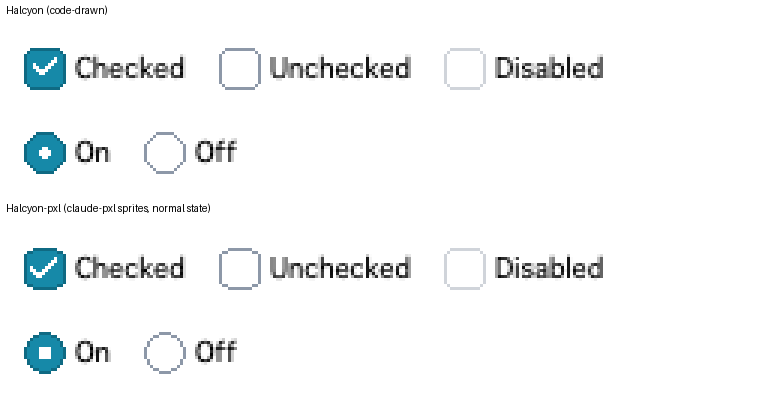
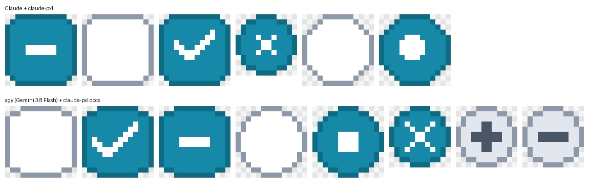
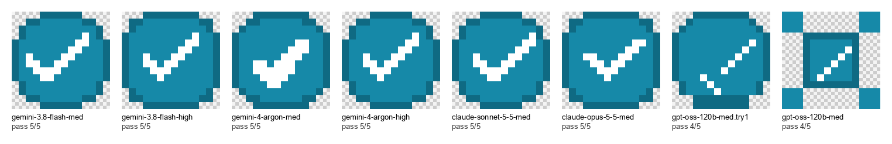
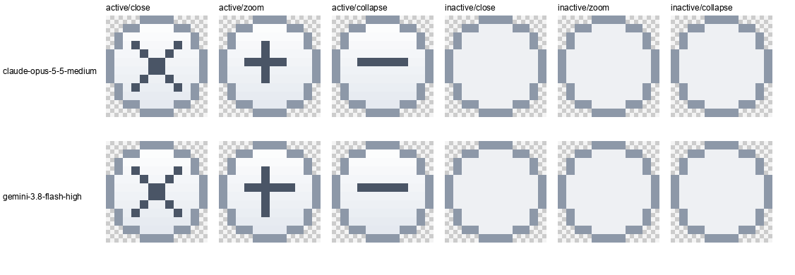
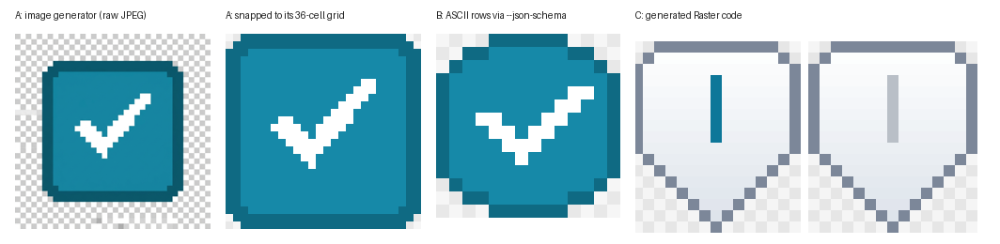
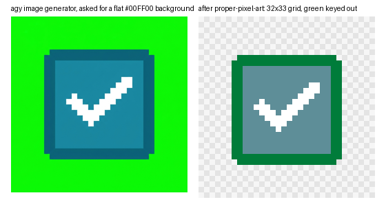

# Getting scheme art from AI tools

*Research log, 2026-10-30. Companion to [`authoring-a-scheme.md`](./authoring-a-scheme.md).
Everything here was tried without setting up any new API keys: Google's
Antigravity CLI (`agy` 1.4.10, already signed in), free local tools, and
Claude in this session. Raw outputs are in
[`authoring/experiments/`](../authoring/experiments/).*

## Summary

**Ask a model for code or text grids, not pictures.** Kaleidoscope art has hard
rules:

- exact pixel sizes;
- a 1-bit mask;
- at most 256 colours (`fitPalette` merges the rarest ones, authoring guide §4.5);
- hidden swatch pixels at exact coordinates ([authoring guide §4](./authoring-a-scheme.md#4-five-ideas-you-need)).

Text output lets the model commit to each pixel, and the result stays editable.
Image models aim for a picture *of* pixel art, and their output can't be
forced onto the right grid afterwards.

| Route | Result | Use it for |
|---|---|---|
| **claude-pxl + any good model** (model writes a `.px.js` file) | Exact sizes, alpha strictly 0/255, every sprite round-tripped exactly; a Halcyon variant rendered correctly | **Best zero-key route.** Control sprites, icons |
| `agy` → ASCII rows (`--json-schema`) | Exact size and palette on the first try | Single small sprites |
| `agy` → `Raster` drawing code (`--json-schema`) | Correct slider thumb and title buttons on the first try | Shapes with gradients; anything parametric |
| `agy` image generator | 1024×1024 JPEG, painted checkerboard, wrong grid, ignored path | Mood boards only |
| Image generator + flat green background + cleanup | Clean 3-colour sprite, but on the model's own grid (20×20, not 16×16) | Concept art you then redraw |

The best model inside `agy` was **Claude Opus 5.5 (medium)**: as good as the
best Gemini output and about six times faster.

## 1. claude-pxl (the best result)

[claude-pxl](https://github.com/crsolver/claude-pxl) (MIT) is an Agent Skill
that treats pixel art as code. You write a `.px.js` file with a palette, text
grids and shape ops (`rect`, `box`, `circ`, `ring`, `line`), then run
`node bin/pxl.js build`. It needs only Node 22.18+, with no install step.

What we found:

- **Output fits our encoder directly.** The 1x PNGs are exactly the declared
  size, with alpha only 0 or 255. A build takes about 0.1 s.
- **`pxl ascii <file> <sprite>` prints the pixel grid as text.** It's a cheaper
  and more exact feedback loop than reading the preview image. The enlarged
  preview's grid lines made a correct border look missing.
- **A model can drive it with no extra setup.** We gave `agy`'s default model
  claude-pxl's own `SKILL.md` and `reference.md` and asked for eight Halcyon
  sprites (checkboxes, radios, title buttons). It wrote a working file in one
  go: [`halcyon-agy.px.js`](../authoring/experiments/pxl/halcyon-agy.px.js).
  Our own hand-written version
  ([`halcyon-claude.px.js`](../authoring/experiments/pxl/halcyon-claude.px.js))
  had an off-centre radio dot.
- **Every sprite survives our pipeline exactly**: PNG, then `Raster`, then
  `encodeCicn`, then the runtime decoder
  ([`png-to-cicn-check.mjs`](../authoring/experiments/pxl/png-to-cicn-check.mjs)).
- **It works in a real scheme.**
  [`authoring/experiments/pxl/variant/`](../authoring/experiments/pxl/variant/)
  is Halcyon with its normal-state checkboxes and radios replaced by those
  sprites. It builds with no checker warnings and renders in the browser:





To use it yourself:

```sh
git clone https://github.com/crsolver/claude-pxl /tmp/pxl     # read it first; it's third-party code
node /tmp/pxl/bin/pxl.js build my-sprites.px.js               # → out/sprites/*.png
node /tmp/pxl/bin/pxl.js ascii my-sprites.px.js checkbox_on   # check pixels as text
```

Then load the PNGs into a scheme. `scripts/lib/png-decode.mjs` reads them, and
`Raster.fromRgba()` wraps the pixels; see
[`variant/scheme.mjs`](../authoring/experiments/pxl/variant/scheme.mjs).
`Raster.fromRgba()` snaps alpha to 0 or 255 and reports how many pixels it
changed. This matters because the encoder treats alpha 1–127 as a hidden
swatch, so an anti-aliased edge would otherwise turn into invisible palette
pixels.

**Unattended image runs are flaky.** Generating Midnight 2027's concept took
five `agy` image runs; four ended "subagent cancelled" at the print timeout
and produced nothing, two of them because runs overlapped. Run one image
job at a time, give it a long `--print-timeout` (1500s), and expect to
retry. Keep every prompt in the scheme's `concept/brief-*.txt` so a retry
is one command.

## 2. Text routes in `agy`

Run from a scratch directory, not the repo, and ask for structured output so
`agy` needs no tools:

```sh
mkdir -p /tmp/agy-lab && cd /tmp/agy-lab
agy -p "Design pixel art as ASCII rows … Do not use tools." \
  --json-schema sprite-schema.json --output-format json --print-timeout 240s > b.json
```

The schema is
[`authoring/experiments/agy/sprite-schema.json`](../authoring/experiments/agy/sprite-schema.json).
Take `response` from the JSON, and use the rows with
`new Raster(w, h).sprite(0, 0, rows, legend)`. For drawing code, paste the
toolkit's method list into the prompt and ask for `{"code": "..."}`. Read the
generated code before running it.

### Model comparison

We ran the same 14×14 checked-checkbox brief through seven models inside `agy`,
plus one round of drawing code for the two best:

| Model | Rows | Seconds | Notes |
|---|---|---|---|
| claude-opus-5-5-medium | all checks passed | 33 | Best overall: 8px straight edges, thin check. Also the best drawing code. Once it nested the whole JSON inside `code`. |
| gemini-3.8-flash-high | all checks passed | 206 | Ties on looks. Its drawing code put the + off-centre, and its first code run timed out at 240 s. |
| claude-sonnet-5-5-medium | all checks passed | 20 | Fastest. Corners read octagonal. Wrote prose before the JSON. |
| gemini-4-argon-medium | all checks passed | 45 | Heavy, blobby check. |
| gemini-3.8-flash-medium (default) | all checks passed | 197 | Octagonal corners. |
| gemini-4-argon-high | all checks passed | 234 | Nearly identical to the default. |
| gpt-oss-120b-medium | failed | 131–199 | One "no capacity" 503, one nonsense drawing. |

All seven ran at the same time, so some of the slow Gemini times may be
contention. Honest caveats:

- At 14px every checkbox reads a little octagonal, and our automatic checks
  didn't separate the good ones.
- Both × glyphs in the drawing-code round have a heavy 2×2 centre at 12px.





## 3. The image route

`agy`'s `image-generator` subagent calls a tool named `generate_image`. By the
subagent's own description, the tool takes a prompt, a name, an aspect ratio
(`1:1`, `2:3`, `3:2`, `3:4`, `4:3`, `9:16`, `16:9`) and optional reference
images. There is no setting for pixel size, format, transparency or save path.
Image generation isn't mentioned in the official
[CLI reference](https://antigravity.google/docs/cli/reference).

- **What we got:** asked for a 16×16 PNG, we got a 1024×1024 JPEG. It had about
  5,000 colours of compression noise, a checkerboard *painted in* as
  "transparency", and a ~36-cell grid with a 26-cell box. It was saved to
  `~/.gemini/antigravity-cli/brain/<conversation-id>/` regardless of the
  requested path. Run with `--output-format json` to get `conversation_id`
  and find the file.
- **Cleanup with the checkerboard:**
  - [`unfake`](https://github.com/painebenjamin/unfake.py) found the grid
    (pitch 28px), then exited during colour quantisation without writing a file.
  - [`proper-pixel-art`](https://github.com/KennethJAllen/proper-pixel-art)
    recovered the true 36×36 grid with clean alpha. But it turned the painted
    checkerboard into a real alternating pixel pattern (it sits on the same
    grid as the art), and it merged the two teals, so the border disappeared.
- **Cleanup with a flat `#00FF00` background** worked: `ppa in.jpg -o out.png -c 5`
  gave a clean 3-colour sprite with the green easy to key out. It was still
  drawn at the model's own size, a 20×20 box rather than 16×16. Shrinking it
  further would break the checkmark.





To finish a cleaned image, ImageMagick can fit it to an exact size with a
locked palette and a 1-bit mask:

```sh
magick out.png -fuzz 6% -transparent '#00FF00' -trim +repage \
  -filter point -sample 16x16\! -dither None -remap palette.png \
  -channel A -threshold 50% +channel PNG32:sprite.png
```

Use this only when the art already sits on the target grid.

## 4. Headless `agy` gotchas

- **Tools are auto-denied in `-p` mode.** One run ended with no output because
  the model tried to run a shell command despite "do not run it".
  Structured output (`--json-schema`) avoids needing any tools.
- **The JSON doesn't always arrive clean.** It has come back twice in one
  reply, wrapped in a code fence, or after a line of prose. Strip a leading
  fence, then parse the first JSON value (Python
  `json.JSONDecoder().raw_decode`).
- **Print mode can exit before a subagent finishes.** Say "wait for it to
  finish before replying". The image subagent also needed a session-only write
  allow rule: `--settings '{"permissions":{"allow":["write_file(/tmp/agy-lab/**)"]}}'`.
- **`--model <id>` picks the main model**, e.g. `claude-opus-5-5-medium`; see
  `agy models`. It doesn't choose the image model.
- **Minor:** `--mode auto` isn't available on every account. The log shows "not
  logged into Antigravity" warnings that didn't block anything.

## 5. Services and skills we looked at but didn't try

These need an API key or a paid account. Prices are as published in October 2026.

| Service | What it offers | Price | Fit |
|---|---|---|---|
| [Retro Diffusion API](https://github.com/Retro-Diffusion/api-examples) | Pixel-art model; exact `width`/`height` 12–512px, `remove_bg`, `input_palette` | $0.03 fast, $0.06 plus, $0.18 pro per image; free `check_cost` dry run | **The only image model that matches the format.** RD Pro goes down to 12px. |
| [PixelLab](https://api.pixellab.ai/v2/llms.txt) | Pixel-art model; no-background and palette options | Subscriptions (third-party reviews say about $10/$30/$50 a month, unverified) | Most tools start at 32px |
| [OpenRouter](https://openrouter.ai/blog/insights/image-generation-models-compared/) | About 20 general image models behind one key | About 1–13¢ per image (their Sept 2026 test) | 1024px+ output, often JPEG/WebP, no transparency documented |
| [Hugging Face Inference Providers](https://huggingface.co/docs/inference-providers/pricing) | Pass-through provider pricing; community pixel-art LoRAs | No markup; PRO includes $2/month credits | No priced hosted pixel-art endpoint found |

Agent Skills we found:

- [claude-pxl](https://github.com/crsolver/claude-pxl): tried, section 1.
- A [Retro Diffusion skill](https://skills.sh/opusgamelabs/game-creator/retrodiffusion) (`playableintelligence/game-creator`): wraps the API above; needs a key.
- Several Nano Banana image skills: general image generation, with the same grid problem.
- AbsolutelySkilled `pixel-art-sprites`: advice only, and now delisted.

## What we didn't try

- **Retro Diffusion or PixelLab**, which need keys. A Retro Diffusion trial
  with a free `check_cost` dry run first is the obvious next step for "let an
  image model propose the art".
- **A feedback loop:** feeding `checkScheme` errors or `pxl ascii` output back
  to the model and asking it to fix its own sprite.
- **Whole window frames from an image model or claude-pxl.** Frames have the
  tightest rules, so they need the checker in the loop. (Agents *have* written
  whole frames as drawing code: Castle, Brickworks and Bonn were each built by
  a fresh agent from the guides, with `frameLayout`'s checks and `checkScheme`
  in the loop. Their friction logs are in
  [`authoring/experiments/round-logs/`](../authoring/experiments/round-logs/).)
- **More states and sizes through claude-pxl:** pressed and disabled sprites,
  and larger art such as icons or frames.
- **More drawing-code models:** beyond the two best row models, and more than
  one run per model, so we can't say how consistent any model is.
- **Reference images for the image route.** `generate_image` accepts reference
  images; giving it a template sprite or a palette strip might pull it onto the
  right grid.
- **Aseprite's command line** for indexed conversion, since it isn't installed here.
- **Loading the claude-pxl variant in real Kaleidoscope.** Halcyon, Castle,
  Brickworks and Bonn have been run in the emulator; the variant hasn't.
