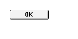

# System7 “OK” label: quarantined partial observation

**QUARANTINED_PARTIAL.** This is one original System7.5.5/Kaleidoscope2.3.1
observation on copied media, prepared and independently reviewed by AI agents.
It is not a human attestation, admitted reference, or ledger promotion.

The public NewControl(proc0)/Draw1Control path rendered an 80×20 normal button
at (20,20), with title bytes `4f4b`, hilite0, variant0, active window and no default
API. Actual before/after font fields were number0/nameChicago/size12/face0/mode1;
FontInfo reported ascent12/descent3/leading1 (widMax was not exported). The port
was white with a full effective clip. Palette, gamma and six other condition
payloads were unchanged across drawing. Full-frame PNG and raw producer bytes
were equal; the repeated producer snapshot was stable. This PNG is the exact
unscaled port extraction. The [index](index.json) binds included files and
explicitly external evidence without shipping original binaries or font data.

A separate published comparison deliberately used the controlled **Virtue**
font with the measured display profile. Its empty face matched the recorded
empty baseline, but “OK” differed at 92 pixels: native ink was 71 black pixels in
15×9, while Virtue produced 127 changed pixels in 19×11. That comparison does not
establish the product's default font or equivalent original font context.

Only O and K from a previously identified private ROM FONT12 candidate were
then decoded using documented bitmap-location and width/offset tables. Their
advances are 8+9=17; the combined 71-pixel mask matches the native ink exactly.
The independent kDEF source placement calculation, with Rect(20,20,100,40),
advance17 and A12/D3/leading1, gives pen(51,34), producing the observed ink bounds
(52,25)–(67,34). This strengthens conditional candidate/output compatibility;
it does **not** prove that the original control consumed that font/provider,
that all glyphs match, or that a modern public compositor has reproduced it.

Original selected font/provider/cache/base/patch ordering and complete transfer
semantics remain unknown. The earlier private candidate overlay used observed
translation; the subsequent source derivation is separate evidence, not a
rewritten claim about how that overlay was positioned. No font mask, FONT
payload, native executable/source, ROM or OS bytes are included. No further
capture was made for this note.
